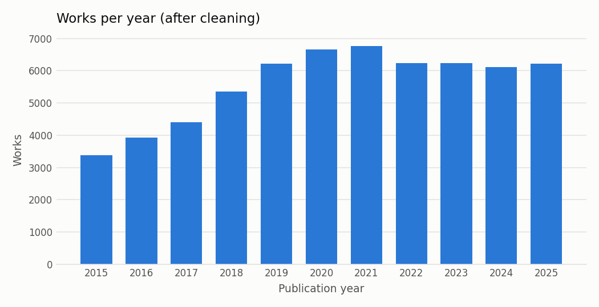
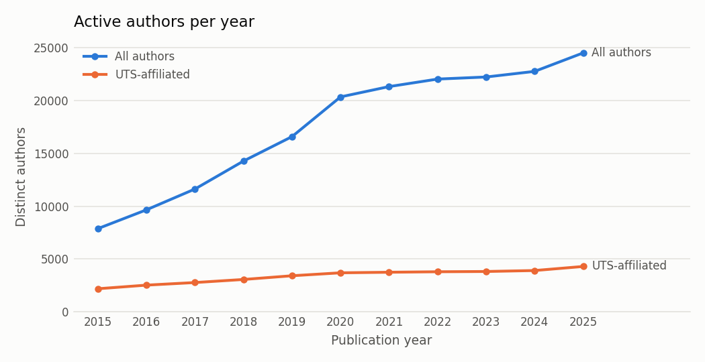
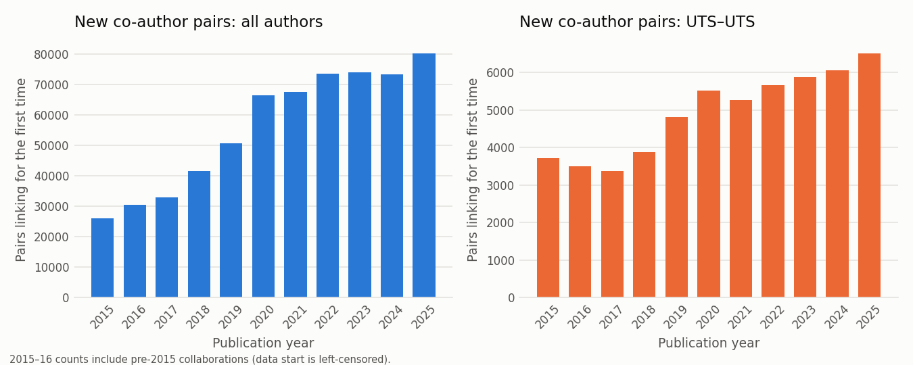
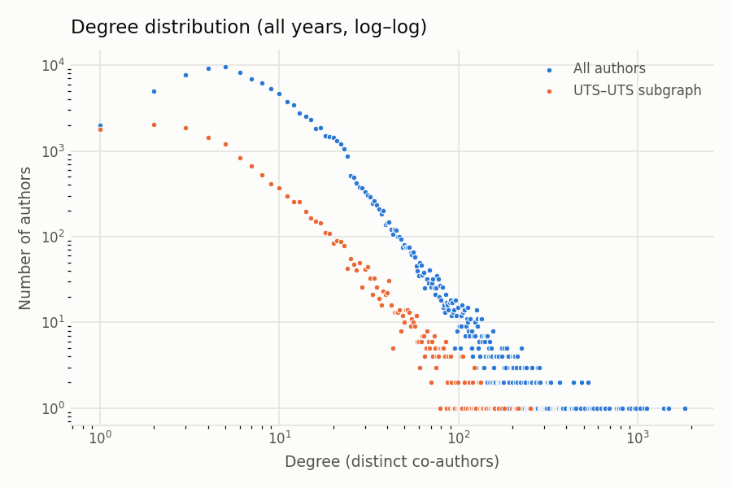
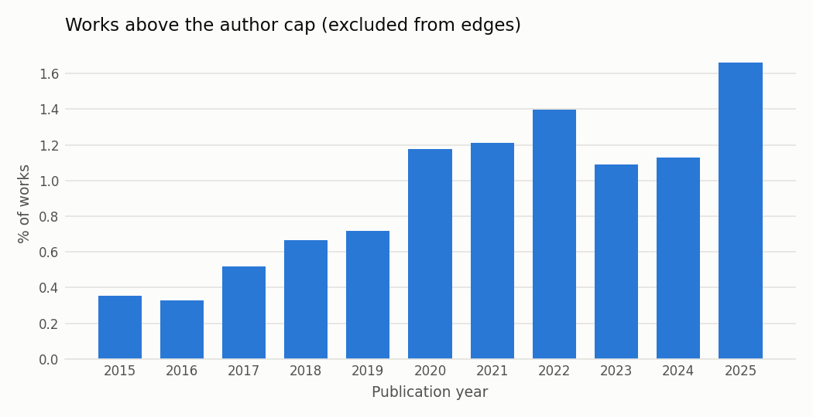

# Data audit

**Source.** Existing OpenAlex snapshot from the earlier UTS project
(`uts-research-intelligence/data/raw/uts_works_2015_2025.json`, read-only), pulled with the
filter `institutions.id:I114017466` (University of Technology Sydney, ROR `03f0f6041`, verified
2026-10-14) for publication years 2015–2025. Built with `make data`
(`linkpred.data.build` then `linkpred.data.audit`). Notebook: `notebooks/01_data_audit.ipynb`.

**What the snapshot contains / lacks.** Per work: OpenAlex ID, publication_year, full
authorships with author IDs and institution IDs (incl. lineage), abstract_inverted_index. It does
**not** contain the `doi` field; DOIs are recovered from `primary_location` (id `doi:…` or a
`doi.org` landing page) for 96.7% of kept works. The OpenAlex list endpoint caps authorships at
100, which only affects works far above the 25-author cap. No re-pull was needed;
`linkpred.data.fetch_openalex` exists to rebuild from scratch.

**Scope decisions (2026-10-14, see `docs/decisions.md`).** Works of type erratum, peer-review
and paratext are dropped before deduplication and edge building. Splits: graph 2015–2022 → predict
2023 (train), 2015–2023 → 2024 (val), 2015–2024 → 2025 (test). Prediction targets are UTS–UTS pairs
only; the input graph keeps all authors and edges before the cutoff.

Every number in the generated block is computed from the files in `report/data_audit/`.

<!-- BEGIN GENERATED -->
_Generated by `linkpred.data.audit` from `report/data_audit/`; do not edit by hand._

## Final dataset
| table | rows |
|---|---|
| works | 61,493 |
| authorships (identified) | 328,399 |
| authors | 113,331 |
| UTS-affiliated authors (ever) | 16,262 |
| edge rows (pair × work) | 966,520 |
| distinct co-author pairs | 616,387 |

## Cleaning steps
| step | count | handling |
|---|---|---|
| Raw works in snapshot | 63,514 |  |
| Missing publication_year | 0 | dropped |
| Excluded types (erratum 283, paratext 242, peer-review 133) | 658 | dropped |
| Duplicate OpenAlex IDs | 0 | dropped |
| Duplicate DOI | 7 | dropped (preferred copy kept) |
| Duplicate normalised title + year (shared author, ≥5-word title) | 1,356 | dropped |
| Works kept | 61,493 |  |
| Works with > 25 authors | 505 | kept in works, no edges |
|   of which authorship list capped at 100 by the API | 80 |  |
| Would-be edge rows from hyper-authored works | 698,260 | not created (lower bound) |
| Authorships without author ID | 10,123 | dropped |
|   works affected | 4,629 |  |
| Self-loops (same author twice on a byline) | 379 | removed |
| Duplicate (pair, work) rows | 2,911 | removed |

## Author disambiguation (flagged, not merged)
Same normalised display name with more than one author ID at the same institution.

| scope | name×institution groups | author IDs involved |
|---|---|---|
| all institutions | 5,550 | 8,961 |
| UTS only | 1,011 | 2,689 |

## Missingness
| level | field | n_missing | n_total | handling | share_missing |
|---|---|---|---|---|---|
| work | publication_year | 0 | 63,514 | dropped | 0 |
| work | doi | 2,035 | 61,493 | kept; title+year dedup only | 0.033 |
| work | title (empty) | 51 | 61,493 | kept | 0.001 |
| work | abstract | 19,950 | 61,493 | kept; has_abstract=False | 0.324 |
| authorship | author_id | 10,123 | 338,522 | dropped | 0.030 |
| authorship | institution_ids (empty) | 9,514 | 328,399 | kept | 0.029 |
| work | no UTS-affiliated identified author | 1,346 | 61,493 | kept | 0.022 |

## Yearly counts
| year | works | works_over_cap | share_over_cap | share_with_abstract | authorships | active_authors | active_uts_authors | new_authors | edge_rows | distinct_pairs | new_pairs | new_pairs_uts_uts |
|---|---|---|---|---|---|---|---|---|---|---|---|---|
| 2015 | 3,374 | 8 | 0.002 | 0.639 | 13,853 | 7,722 | 2,163 | 7,722 | 32,394 | 26,063 | 26,063 | 3,707 |
| 2016 | 3,933 | 9 | 0.002 | 0.649 | 16,900 | 9,450 | 2,491 | 6,739 | 43,381 | 35,490 | 30,478 | 3,497 |
| 2017 | 4,404 | 17 | 0.004 | 0.673 | 19,864 | 11,284 | 2,744 | 7,446 | 49,836 | 40,465 | 32,915 | 3,365 |
| 2018 | 5,351 | 27 | 0.005 | 0.642 | 24,863 | 13,793 | 3,033 | 8,770 | 64,055 | 52,056 | 41,505 | 3,878 |
| 2019 | 6,210 | 35 | 0.006 | 0.618 | 29,751 | 16,175 | 3,385 | 9,695 | 81,291 | 64,826 | 50,685 | 4,809 |
| 2020 | 6,652 | 62 | 0.009 | 0.660 | 35,952 | 19,727 | 3,669 | 11,823 | 105,908 | 84,284 | 66,444 | 5,518 |
| 2021 | 6,773 | 74 | 0.011 | 0.659 | 37,890 | 20,839 | 3,722 | 11,699 | 112,676 | 89,861 | 67,475 | 5,268 |
| 2022 | 6,231 | 73 | 0.012 | 0.681 | 37,504 | 21,166 | 3,767 | 11,771 | 120,031 | 96,498 | 73,460 | 5,661 |
| 2023 | 6,245 | 56 | 0.009 | 0.681 | 37,624 | 21,629 | 3,775 | 11,942 | 120,516 | 96,731 | 73,930 | 5,882 |
| 2024 | 6,105 | 53 | 0.009 | 0.738 | 36,701 | 22,007 | 3,876 | 12,057 | 117,074 | 97,054 | 73,351 | 6,051 |
| 2025 | 6,215 | 91 | 0.015 | 0.762 | 37,497 | 24,207 | 4,266 | 13,667 | 119,358 | 103,829 | 80,081 | 6,497 |

## Graph summary (all years, distinct pairs)
| graph | nodes | edges | components | giant_component_share | mean_degree | median_degree | max_degree | density |
|---|---|---|---|---|---|---|---|---|
| all authors | 100,121 | 616,387 | 1,046 | 0.9489 | 12.31 | 8 | 1,825 | 0.000123 |
| UTS–UTS | 14,150 | 61,567 | 339 | 0.9302 | 8.702 | 4 | 250 | 0.000615 |

## Configured splits (target: UTS–UTS pairs)
`pos_uts_uts` are the prediction targets: pairs first co-authoring in the label window, both in the graph before the cutoff and both with a UTS authorship before the cutoff. The other positive counts are context only.

| split | graph_years | label_window | graph_nodes | graph_edges_distinct | uts_nodes | pos_uts_uts | pos_uts_any_both_seen | pos_both_seen | new_pairs_in_window |
|---|---|---|---|---|---|---|---|---|---|
| train | <2023 | 2023-2023 | 67,287 | 389,025 | 10,962 | 2,244 | 6,471 | 10,845 | 73,930 |
| val | <2024 | 2024-2024 | 77,933 | 462,955 | 12,376 | 2,216 | 6,757 | 10,881 | 73,351 |
| test | <2025 | 2025-2025 | 88,562 | 536,306 | 13,829 | 2,533 | 7,228 | 11,717 | 80,081 |

## Split candidates
Positives = pairs first co-authoring inside the window whose two authors are both already in the graph before the cutoff. `pos_uts_uts` also requires both to have had a UTS affiliation before the cutoff.

| cutoff | window_end | graph_nodes | uts_nodes | new_pairs_in_window | pos_both_seen | share_both_seen | pos_uts_any_both_seen | pos_uts_uts |
|---|---|---|---|---|---|---|---|---|
| 2017 | 2017 | 13,398 | 3,265 | 32,915 | 2,994 | 0.091 | 2,249 | 1,044 |
| 2017 | 2018 | 13,398 | 3,265 | 74,420 | 5,457 | 0.073 | 4,123 | 1,934 |
| 2017 | 2019 | 13,398 | 3,265 | 125,105 | 7,319 | 0.059 | 5,562 | 2,605 |
| 2018 | 2018 | 19,996 | 4,457 | 41,505 | 4,285 | 0.103 | 3,139 | 1,396 |
| 2018 | 2019 | 19,996 | 4,457 | 92,190 | 7,657 | 0.083 | 5,660 | 2,536 |
| 2018 | 2020 | 19,996 | 4,457 | 158,634 | 10,559 | 0.067 | 7,793 | 3,412 |
| 2019 | 2019 | 27,888 | 5,682 | 50,685 | 5,948 | 0.117 | 4,263 | 1,775 |
| 2019 | 2020 | 27,888 | 5,682 | 117,129 | 11,033 | 0.094 | 7,849 | 3,255 |
| 2019 | 2021 | 27,888 | 5,682 | 184,604 | 14,958 | 0.081 | 10,667 | 4,418 |
| 2020 | 2020 | 36,569 | 6,967 | 66,444 | 8,044 | 0.121 | 5,466 | 2,197 |
| 2020 | 2021 | 36,569 | 6,967 | 133,919 | 14,041 | 0.105 | 9,639 | 3,868 |
| 2020 | 2022 | 36,569 | 6,967 | 207,379 | 18,762 | 0.090 | 13,001 | 5,107 |
| 2021 | 2021 | 46,845 | 8,325 | 67,475 | 9,769 | 0.145 | 6,129 | 2,290 |
| 2021 | 2022 | 46,845 | 8,325 | 140,935 | 17,052 | 0.121 | 11,093 | 4,092 |
| 2021 | 2023 | 46,845 | 8,325 | 214,865 | 22,543 | 0.105 | 14,758 | 5,479 |
| 2022 | 2022 | 56,895 | 9,600 | 73,460 | 10,482 | 0.143 | 6,719 | 2,364 |
| 2022 | 2023 | 56,895 | 9,600 | 147,390 | 18,168 | 0.123 | 11,631 | 4,156 |
| 2022 | 2024 | 56,895 | 9,600 | 220,741 | 23,775 | 0.108 | 15,182 | 5,391 |
| 2023 | 2023 | 67,287 | 10,962 | 73,930 | 10,845 | 0.147 | 6,471 | 2,244 |
| 2023 | 2024 | 67,287 | 10,962 | 147,281 | 18,409 | 0.125 | 11,238 | 3,857 |
| 2023 | 2025 | 67,287 | 10,962 | 227,362 | 24,725 | 0.109 | 15,130 | 5,205 |
| 2024 | 2024 | 77,933 | 12,376 | 73,351 | 10,881 | 0.148 | 6,757 | 2,216 |
| 2024 | 2025 | 77,933 | 12,376 | 153,432 | 19,514 | 0.127 | 12,152 | 4,094 |
| 2025 | 2025 | 88,562 | 13,829 | 80,081 | 11,717 | 0.146 | 7,228 | 2,533 |

## Figures

<!-- END GENERATED -->

## Interpretation

1. **Most new links involve a newcomer.** Only 9–15% of the pairs that co-author for the first
   time in a year (12–15% for cutoffs from 2020 on) have *both* authors already in the graph
   (`share_both_seen`, one-year windows). The task covers that minority, and the report must say so.
2. **Why UTS–UTS targets.** Every work with a UTS author is in the data, so any collaboration
   between two UTS authors is observed: both positive and negative labels are reliable. For pairs
   with a non-UTS author, collaborations on non-UTS papers are invisible, so negatives would hide
   false negatives. All-pairs counts are kept in the tables above for context only.
3. **Effect of the excluded types.** Dropping 658 errata, front-matter and peer-review records also
   removed 118 over-cap works (92 paratext, 21 errata, 5 peer reviews): over-cap works fall from
   623 to 505, now 0.8% of works (1.5% in 2025).

## Limitations

- **OpenAlex indexing lag for 2025.** The snapshot was pulled in August 2026. 2025 has 6,215 works,
  in line with 2022–2024 (6,105–6,245), but late-indexed works may still be missing. Missing 2025
  co-authorships would appear as negatives in the test window, making it slightly harder for
  every model alike; the test numbers should be read as a lower bound in that respect.
- **Left-censoring.** The data start in 2015, so 2015–2016 "new" pairs include older
  collaborations and early graphs are thin. Pre-2015 history of every author is unobserved.
- **Partial observation of external authors.** Non-UTS authors' histories contain only their
  UTS-linked papers, and UTS authors' pre-UTS / non-UTS papers are missing too. Structural features
  of external nodes in the input graph are biased downward.
- **Author disambiguation.** 1,011 (name, UTS) groups map to more than one author ID (2,689 IDs).
  Split profiles make a continuing collaboration look new; merged profiles create artificial hubs
  (several of the highest-degree authors are flagged). Nothing is merged; a Phase 7 sensitivity
  check removes the flagged IDs.
- **Authorship truncation.** The OpenAlex list API caps authorships at 100 (80 works); this only
  affects works already excluded from edges by the 25-author cap.
- **Missing DOIs** (3.3% of works) can only be deduplicated by title + year.
