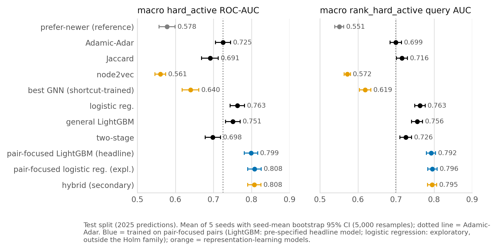
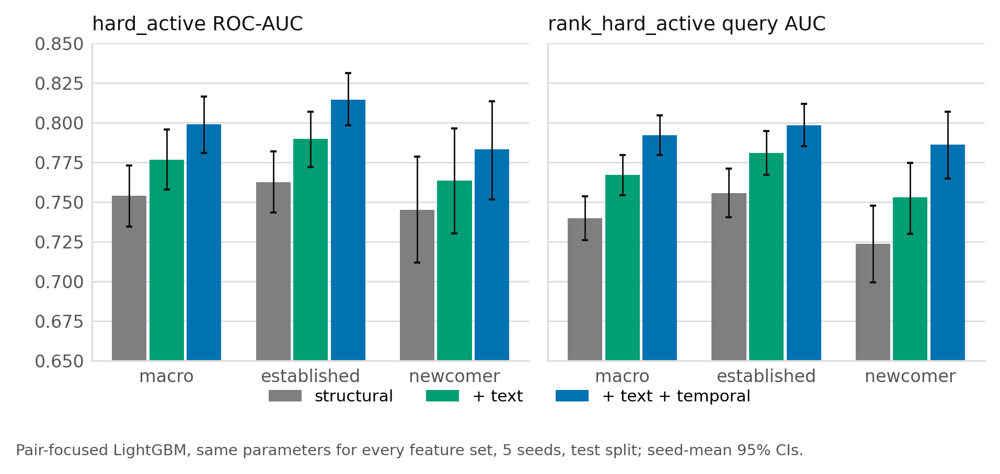
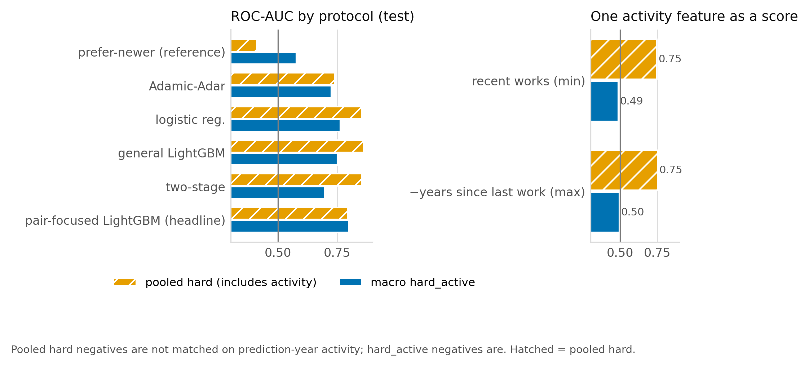
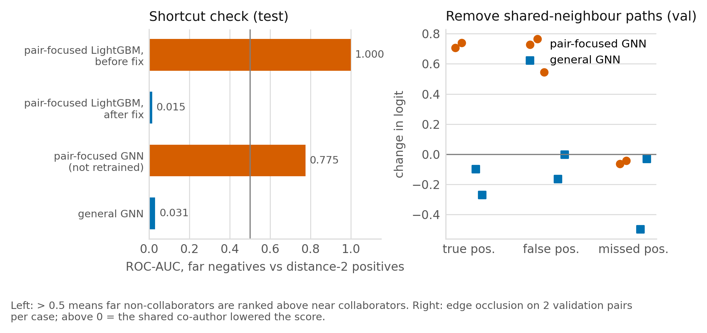
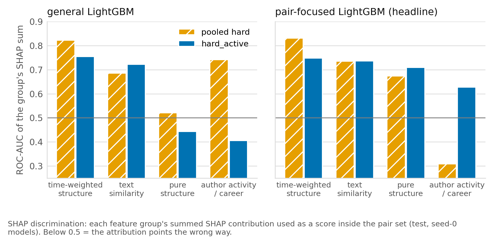

# Abstract

We predict which pairs of University of Technology Sydney (UTS) researchers will co-author for the first time in the
next year, using only the co-authorship graph and publications from before a cutoff. The main contribution is the
evaluation. Under a leak-free temporal split with negatives that share a co-author and are both still publishing,
and with scores computed separately for established and newcomer authors, the models that do best are trained on
the same kind of pairs they are evaluated on. The pre-specified headline model, a LightGBM trained this way, reaches
a macro ROC-AUC of 0.799 [0.781, 0.816] and a macro ranking AUC of 0.792 [0.780, 0.804] on the 2025 test year
(validation year: 0.824 and 0.800). The validation-best heuristics
score 0.725 (Adamic-Adar) and 0.716 (Jaccard); the gains are +0.074 and +0.077, both p < 0.01 (the smallest value
this test can show), and they stay clear of zero when the bootstrap resamples authors instead of pairs. A logistic
regression trained on the same pairs scores about the same (0.808 and 0.796; exploratory), so the gain comes from
choosing the training pairs, not from the learner. node2vec (0.561) and a graph neural network trained with a known flaw (0.640) score
below the heuristics. Text features add +0.023 beyond network structure. Three findings come from the evaluation
itself: protocols that do not match negatives on publishing activity reward predicting who keeps publishing, pooled
scores reward newcomer status, and a training set whose negatives are all at distance 2 teaches models a distance
shortcut, visible in a CPU replica of the graph neural network.

**Two caveats come first.** (1) Two choices that define the headline protocol, matching negatives on activity and
scoring within newcomer and established groups, were adopted after diagnostics on the test year, before a
validation-first rule was in place; the test year is not a clean confirmation of those two choices. Validation
numbers are given beside test numbers in Table 1; most other numbers in this report are test-year only. (2) The headline protocol keeps only negatives whose authors
both publish in the prediction year, which is known only afterwards. It measures pair signal given activity; a
deployed recommender would need a shortlisting step first. A model of "both authors active" reaches a test ROC-AUC of
0.881, but multiplying it with the pair-focused LightGBM did not beat a LightGBM trained against random pairs
(Section 7).

# 1. Introduction

Research offices, funders and researchers use collaboration recommendations to find partners for grants, to plan
hiring and to spot groups that could work together. Whether such recommendations are useful depends on how well new
collaborations can be predicted, and on whether reported accuracy reflects the task or the evaluation. Link
prediction in co-authorship networks is a standard benchmark [Liben-Nowell and Kleinberg 2007], and simple
neighbourhood scores such as Adamic-Adar remain hard to beat [Adamic and Adar 2003]. At the same time,
evaluation choices such as random splits and easy random negatives can inflate scores [Yang et al. 2015];
[Li et al. 2023].

We study one institution, UTS, using OpenAlex data from 2015 to 2025 [Priem et al. 2022]. Three research questions
were set in the project plan before any data work began. They entered the repository in Phase 7; before that, a
reconstructed set was briefly recorded, and it is marked as superseded in the decision log:

1. **RQ1.** How much do learned models (GNNs, embeddings, feature models) improve over simple graph heuristics for
   predicting new collaborations?
2. **RQ2.** Do topical signals (what researchers publish on) add predictive value beyond network structure?
3. **RQ3.** Which features drive predictions, and where do models fail (e.g. newcomers, cross-discipline pairs)?

Along the way the evaluation design changed several times, each change recorded with its reason in the project's
decision log. Those changes produced the findings we consider most useful, and we report them separately from the
research questions (Section 7).

# 2. Related work

**Heuristics.** Liben-Nowell and Kleinberg framed link prediction in co-authorship networks and compared
neighbourhood and path scores [Liben-Nowell and Kleinberg 2007]. Adamic-Adar weights common neighbours by the
inverse log of their degree [Adamic and Adar 2003]; resource allocation uses the inverse degree [Zhou et al.
2009]; the Katz index counts paths of all lengths with decaying weights [Katz 1953]. Co-authorship
networks are known to be highly clustered, which is why common-neighbour scores work well [Newman 2001].

**Learned representations.** node2vec learns node embeddings from biased random walks [Grover and Leskovec 2016]. GraphSAGE [Hamilton et al. 2017] and graph attention networks [Velickovic et al. 2018]
aggregate neighbour features and apply to unseen graphs. We use gradient-boosted trees as implemented in LightGBM
[Ke et al. 2017] for engineered pair features.

**Explanations and statistics.** SHAP attributes a prediction to features using Shapley values [Lundberg and Lee 2017], with an exact algorithm for tree ensembles [Lundberg et al. 2020]. For graph models we use
GNNExplainer [Ying et al. 2019] and integrated gradients [Sundararajan et al. 2017]. Confidence
intervals use the bootstrap [Efron and Tibshirani 1993]; multiple comparisons are corrected with Holm's
procedure [Holm 1979]; probability calibration uses Platt scaling [Platt 1999].

**Evaluation pitfalls.** Yang et al. show that link-prediction results depend strongly on how test pairs and negatives
are sampled and on temporal leakage [Yang et al. 2015]. Li et al. report that common GNN link-prediction
benchmarks use easy negatives and inconsistent settings, and that harder, more realistic negatives change model
rankings [Li et al. 2023]. Our protocols follow this line and add two controls we did not find in that
work: matching negatives on publishing activity in the prediction year, and scoring newcomer and established
authors separately.

# 3. Data

The input is the set of OpenAlex works with at least one UTS-affiliated author, 2015 to 2025: 63,514 raw records and
61,493 works after cleaning (errata, peer reviews and paratext removed, duplicates merged). Works with more than 25
authors are kept for author statistics but produce no edges, since large consortia create cliques that do not reflect
working relationships. Abstracts are missing for 32% of works; text features use titles and, where present, abstracts.

Author identities are OpenAlex author IDs. We flag possible split profiles (same normalised name, more than one ID at
the same institution): 1,011 such groups at UTS involve 2,689 IDs. These are flagged, not merged; Section 9 reports a
sensitivity analysis that removes them.

# 4. Method

**Temporal splits.** Each split has an input graph built only from works before a cutoff year and a one-year label
window: train predicts 2023 from works before 2023, validation predicts 2024, and test predicts 2025. The test input
graph has 88,562 authors and 536,306 distinct co-author pairs. Every feature, degree, embedding, normalisation
statistic and negative candidate is computed from the input graph and pre-cutoff works only, and unit tests fail if
future information enters.

**Targets.** A positive is a pair of UTS authors, both present before the cutoff, who co-author for the first time in
the label window (any team size counts as a joint work for this purpose). Test has 2,533 positives and validation
2,225.

**Negatives and protocols.** All models are scored on the same saved pairs.

- `random`: all positives against an equal number of random unconnected UTS pairs. Easy: most random pairs are far
  apart in the graph.
- `hard`: positives at distance 2 (sharing at least one co-author) against non-collaborating pairs at distance 2.
- `hard_active`: as `hard`, but both authors of every negative also publish in the prediction year. This removes the
  question "is this person still active?" from the task. Prediction-year activity is used only to choose evaluation
  pairs and training labels, never as a model input. Test has 1,684 positives and 1,684 negatives.
- `rank_hard_active`: each distance-2 positive ranked against up to 100 active, distance-2 candidates for the same
  author, scored by the per-query AUC.

**Macro within-group scores.** Activity matching makes newcomers (authors with at most two works before the cutoff)
rare among negatives, while they are common among positives. A pooled score then rewards any model that ranks
newcomers high. The headline metric therefore compares positives with negatives (or candidates) from the same group,
established or newcomer, and averages the two groups' scores. Pooled numbers are kept and labelled.

**Models.** Heuristics: common neighbours, Jaccard, Adamic-Adar, resource allocation, preferential attachment and
truncated Katz. A reference score, `prefer-newer`, ranks pairs by how few prior works the less experienced author has;
it uses no pair information and shows how much a protocol rewards newcomer status. Feature models use 27 pair
features in three blocks: structural (neighbourhood counts, Katz, degrees, distance, communities, shared institutions),
temporal (career age, recent output, years since last work, recency-weighted common neighbours and Adamic-Adar) and
text (cosine similarity of the authors' mean title and abstract embeddings, and of each author to the other's
co-authors). The **general** models, a general logistic regression and a general LightGBM, are trained on
train-split positives against random negatives. The **pair-focused LightGBM** is trained on distance-2 positives
against activity-matched distance-2 negatives from the train window, the same kind of pairs it is evaluated on. It
is the **headline model**: it was fixed as the headline before the final checks, including the pair-focused logistic
regression, and it stays the headline although it is not the highest-scoring model. The **pair-focused logistic
regression**, trained on exactly the same pairs, was added in the final pass as an exploratory check outside the Holm
family. node2vec embeddings are aligned across
splits with orthogonal Procrustes. GraphSAGE and GAT models were trained on a GPU with a general and a pair-focused
objective. A hybrid adds the best GNN's out-of-fold score to the pair-focused LightGBM.

# 5. Experimental setup

All hyperparameters, negative-mix choices and early stopping use the validation split. Learned models run with five
seeds; values are the mean over seeds with a seed-mean bootstrap 95% interval. The primary test for each comparison is
one paired bootstrap on seed-averaged scores with 5,000 resamples, and all primary comparisons form one family of 34
tests corrected with Holm's procedure. The family was extended in steps, each time in the decision log before the new
comparison was run on test. With 5,000 resamples and 34 tests, the smallest Holm-adjusted value the procedure can
show is 0.0068; results at that floor are written as p < 0.01 (the smallest value this test can show). Gains are
reported against the validation-best heuristic for each protocol (Adamic-Adar on `hard_active`, Jaccard on
`rank_hard_active`), with Adamic-Adar kept as a named comparator throughout.

Pairs share authors, so pair-level resampling treats dependent observations as independent. As a sensitivity
analysis (exploratory, outside the family) we repeat the headline comparisons with an author-clustered bootstrap:
each resample gives every author a Poisson(1) weight and each pair the product of its two authors' weights (for
ranking, each query the product of its positive pair's weights). The same estimator with weights per pair reproduces
the primary intervals, so the two can be compared directly.

# 6. Results by research question

{width=100%}

**RQ1: learned models against heuristics.** Table 1 and Figure 1 give the results. The headline model beats
the validation-best heuristic on both headline protocols: Adamic-Adar on macro `hard_active` by +0.074 [+0.058,
+0.091], and Jaccard on macro `rank_hard_active` by +0.077 [+0.064, +0.091] (exploratory test; +0.093 [+0.081,
+0.106] against Adamic-Adar), all p < 0.01 (the smallest value this test can show). It beats the general LightGBM by
+0.048. The general feature models gain much less over the heuristic: +0.038 for logistic regression and +0.027
[+0.009, +0.044] for the general LightGBM.

*Is it the model or the training pairs?* An exploratory logistic regression trained on exactly the pair-focused
LightGBM's training pairs scores 0.808 on `hard_active` and 0.796 on `rank_hard_active` (validation 0.831 and 0.803).
LightGBM minus logistic regression is -0.008 [-0.015, -0.002] on `hard_active` (raw p 0.016) and -0.003 [-0.009,
+0.003] on `rank_hard_active` (raw p 0.38); both are exploratory and outside the Holm family. The two learners are
roughly tied, and the pair-focused LightGBM is additive anyway (2-leaf trees, Section 8). The gain comes from
training on the same kind of pairs as the evaluation and is not specific to LightGBM.

*Clustered intervals.* Resampling authors instead of pairs widens the intervals by a factor of 1.89 to 2.08 on test.
The headline gains stay clear of zero: pair-focused LightGBM against Adamic-Adar +0.074 [+0.044, +0.106] and +0.093
[+0.070, +0.118]; against Jaccard on ranking +0.077 [+0.052, +0.104]. The small heuristic differences do not survive:
Jaccard against Adamic-Adar becomes -0.034 [-0.078, +0.009] on `hard_active` and +0.016 [-0.012, +0.047] on
`rank_hard_active`, so the heuristics should be treated as tied.

*Representation learning,* as tested here, did not help, but the test is narrow: node2vec and a GNN trained with the
distance shortcut described in Section 7. node2vec scores 0.561 and the GNN 0.640, both significantly below
Adamic-Adar. node2vec even scores below the `prefer-newer` reference (0.578), which uses no pair information. We
checked for a bug: the embeddings themselves are sound (their raw cosine similarity separates collaborators from
random pairs with ROC-AUC 0.915 on test and correlates 0.529 with Adamic-Adar on `hard_active` pairs), and the cosine alone
scores 0.635 on macro `hard_active`, above the reference. The weak number comes from the classifier on the L1 edge
operator, which validation selected but which reaches only 0.675 even on random pairs. The GNN's ceiling is unknown
because it was not retrained after the shortcut was found. The hybrid adds +0.009 [+0.005, +0.014] over the
pair-focused LightGBM, a small gain from a shortcut-trained model, and we treat it as secondary: its 0.808 equals the
pair-focused logistic regression's, so the GNN adds no more than changing the learner does.

| Model | macro hard_active ROC-AUC, val / test | macro rank_hard_active query AUC, val / test |
|---|---|---|
| prefer-newer (reference) | 0.576 / 0.578 | 0.561 / 0.551 |
| Adamic-Adar | 0.741 / 0.725 | 0.722 / 0.699 |
| Jaccard | 0.692 / 0.691 | 0.729 / 0.716 |
| logistic regression (general) | 0.782 / 0.763 | 0.767 / 0.763 |
| general LightGBM | 0.766 / 0.751 | 0.761 / 0.756 |
| pair-focused LightGBM (pre-specified headline model) | 0.824 / 0.799 | 0.800 / 0.792 |
| pair-focused logistic regression (exploratory) | 0.831 / 0.808 | 0.803 / 0.796 |
| node2vec | 0.580 / 0.561 | 0.579 / 0.572 |
| best GNN (shortcut-trained) | 0.637 / 0.640 | 0.610 / 0.619 |
| hybrid (secondary) | 0.828 / 0.808 | 0.804 / 0.795 |

: Validation (2024) / test (2025) results, mean of 5 seeds for learned models. The pre-specified headline row is marked; it is not the highest-scoring row. The pair-focused logistic regression is exploratory.

An AUC of 0.80 means that in about one in five comparisons between a future collaborator and an active
non-collaborator at the same distance, the model ranks them the wrong way round. That is useful for ordering
candidates, not for predicting individual collaborations.

{width=100%}

**RQ2: topical signals.** We trained the pair-focused LightGBM on structural features only, on structural plus text,
and on all features, with the same parameters (Figure 2). Adding the four text features raises macro `hard_active`
from 0.754 to 0.777 (+0.023 [+0.013, +0.033], p < 0.01, the smallest value this test can show) and macro `rank_hard_active` from 0.740 to 0.767
(+0.027). Validation shows the same direction. The gain holds in both groups for ranking and for established pairs
on `hard_active`; for newcomer pairs on `hard_active` it is +0.019 [+0.002, +0.036], not significant after correction
(Holm p = 0.0536). Adding the temporal block on top adds a further +0.022. An exploratory run that adds the blocks in
the other order gives text a similar increment after the temporal block (+0.017 on test), so the answer does not
depend on order. Topical similarity helps, by about as much as the temporal block, but structure alone already gives
0.754 of the final 0.799.

**RQ3: drivers and failures.** Section 8 gives the evidence. In short, the headline model relies mostly on
recency-weighted shared neighbourhoods and on topical similarity, and it fails most on newcomer pairs and on
collaborations that have no network or topical precursor. Cross-field pairs, under a coarse field definition, are not
a weak spot.

# 7. Emergent findings

These results answer none of the three questions but shaped the evaluation.

{width=100%}

**Activity confound.** When negatives are not matched on activity, part of the task is predicting who keeps
publishing. The general LightGBM scores 0.864 on pooled `hard` but 0.751 on macro `hard_active`. A single feature,
the smaller of the two authors' recent work counts, scores 0.749 on pooled `hard` and 0.488 on macro `hard_active`
(Figure 3). This is why `hard_active` is the headline protocol.

**Newcomer imbalance.** The `prefer-newer` reference uses no pair information. It scores 0.647 on pooled
`hard_active` but 0.578 macro: the pooled number rewards newcomer composition alone.

**Distance shortcut.** An early version of the pair-focused LightGBM was trained on activity-matched negatives, which
are all at distance 2, against positives at any distance. Distance alone then separates the classes. On the test
`random` protocol, that model ranked far random non-collaborators above distance-2 collaborators with ROC-AUC 1.000;
after retraining on distance-2 positives the same check gives 0.015. The best GNN was trained the same way before the
problem was found and was not retrained; its check is 0.775 (Figure 4).

**Two-stage model.** A model of the form P(both authors active) times P(collaborate given both active) scores 0.854
on pooled `hard` against 0.864 for the general LightGBM (-0.010 [-0.016, -0.005], p < 0.01), although its
activity component is accurate on its own task (test activity ROC-AUC 0.881). Calibrating both components on
training-split out-of-fold predictions does not close the gap (-0.013). The general model learns activity and the
pair signal jointly; the product of two separately trained models loses that interaction.

# 8. Explainability and error analysis

{width=100%}

**What the models use.** All explanations, the error analysis and the calibration below use the headline model
(the pair-focused LightGBM). They were not repeated for the pair-focused logistic regression, which scores about the
same; because the LightGBM is additive, its drivers are likely similar, but this was not checked. We computed exact
TreeSHAP values for seed-0 models. The pair-focused LightGBM uses 2-leaf
trees, so it is additive and has no interactions. Grouped by what the features measure (test), recency-weighted
shared structure takes 0.281 of mean absolute SHAP, text similarity 0.281, plain structure 0.248 and author activity
or career 0.190. Filed by code block it would look like a "temporal" model (0.471), because the recency-weighted
common-neighbour features sit in that block. Mean absolute SHAP measures distance from the training average, not
discrimination, so we also score each group's SHAP sum as a predictor inside each pair set (Figure 5). For the
general LightGBM, the activity group discriminates on pooled `hard` (0.742) and points the wrong way on `hard_active`
(0.406). For the headline model the pattern is reversed (0.309 and 0.627): trained among active authors, it uses
activity only to rank within them.

{width=100%}

**The shortcut, seen in a CPU replica.** No GNN weights were saved during GPU training, so we retrained both GNNs on
CPU from their saved configurations. The replicas are close but not identical: their validation scores correlate
0.955 to 0.987 with the evaluated models, and the replica of the pair-focused GNN has a validation shortcut check of
0.780, consistent with the 0.775 of the evaluated model on test. In that replica, removing every path through a
shared co-author raised the score of each of the 4 most confident predictions we examined (2 true and 2 false
positives; +0.71, +0.74, +0.77 and +0.54 in logit): it treats a shared co-author as evidence against a link. Four
predictions illustrate the mechanism; the shortcut check measures its extent. Its most confident
validation predictions are disconnected pairs with no common neighbour (logits 8.2 and 7.8, against 0.89 for its best
true positive). For the general GNN, the same deletion lowers or leaves the score (-0.50 to -0.00). GNNExplainer masks
were close to uniform and did not support conclusions; integrated gradients and edge deletion did.

**Errors (headline model, validation).** Among established pairs, the most confident false positives share
more co-authors (median 5 against 1 for all negatives) and are topically closer (text similarity 0.669 against 0.362);
4 of the top 100 co-authored in the following year, against 0.7% of all negatives, so some errors are early rather
than wrong. Missed collaborations have lower text similarity and are more often cross-field than other positives in
both groups. Newcomer pairs are harder for every model: on test the headline model scores 0.783 for newcomer pairs and
0.815 for established ones, and no model does better on newcomers once negatives are group-matched.

**Cross-field pairs.** Each author's field is the most common OpenAlex field of their works before the cutoff
(26 fields), and both positives and negatives are split by the pair's own field relation. On test the headline model
scores 0.830 on cross-field pairs and 0.792 on same-field pairs. This is consistent with the error result above:
cross-field pairs make up 47% of new collaborations but 60% of non-collaborations, so being cross-field counts
against a pair and cross-field collaborators are more often missed, yet within the cross-field subset the model
separates collaborators from non-collaborators well. One field per author out of 26 is coarse, and a finer definition
could change this.

**Calibration.** Neither model's scores are probabilities. On test `hard_active` pairs the general LightGBM has a
Brier score of 0.417, worse than the 0.250 of always predicting the base rate, because it predicts about 0.93 for
pairs of which half collaborate. The headline model scores 0.230 and under-predicts. The evaluation sets are sampled
about 1:1, while real new collaborations are a tiny fraction of all pairs, so the scores should be used for ranking
only.

# 9. Limitations

- **Test-set reuse** (see the caveats after the abstract). Validation numbers are given beside test in Table 1;
  all decisions after the validation-first rule used validation only.
- **Disambiguation.** The split-profile flag is a heuristic and also catches correctly identified authors who share a
  name. Removing all flagged IDs reduces the test positives from 2,533 to 1,546. The main result holds on that
  subset (pair-focused LightGBM 0.780 against Adamic-Adar 0.710, difference +0.071, p < 0.01), but it is a smaller,
  different population. Merged profiles cannot be detected this way.
- **OpenAlex coverage and indexing lag.** The data reflect OpenAlex at the time of the snapshot. Works from 2025 are
  likely to be under-indexed, which affects the test labels; a fresh download would differ slightly.
- **Right-censoring.** A pair counted as a negative may collaborate later. This can be checked on validation for one
  later year only, and not at all for test.
- **Single institution.** Only collaborations between UTS authors are targets, and the graph covers UTS works.
  Results may not transfer to other institutions or to cross-institution collaborations.
- **GNN not retrained.** The GNNs were trained before the distance shortcut was found and were not retrained, so the
  GNN results may understate what a correctly trained GNN could do, and the hybrid is built on a shortcut-trained
  model. Retraining without the shortcut is the first item of future work.

**Future work.** Retrain the GNNs without the distance shortcut (distance-2 positives only, now the default in the
code) and repeat the comparison and explanations; evaluate on a clean held-out year (2026); design and test a
deployable shortlisting step for the activity condition.

# 10. Conclusion

Under a strict evaluation, new UTS collaborations are moderately predictable. A LightGBM trained on the same kind of
pairs it is scored on beats the best heuristic by about 0.07 to 0.08 AUC, and a logistic regression trained on the
same pairs does as well, so the training pairs matter more than the learner. node2vec and the shortcut-trained GNN
tested here do not beat the heuristics, and topical similarity adds a small, consistent gain beyond structure. The larger lesson is about
evaluation: unmatched activity, pooled newcomer composition and distance-matched training negatives each produce
convincing numbers that do not measure the task, and each was found only by building controls and reference scores
into the evaluation.

# References

- Adamic, L. A., and Adar, E. (2003). Friends and neighbors on the Web. *Social Networks*, 25(3), 211-230.
- Efron, B., and Tibshirani, R. J. (1993). *An Introduction to the Bootstrap*. Chapman and Hall.
- Grover, A., and Leskovec, J. (2016). node2vec: Scalable feature learning for networks. *Proceedings of KDD 2016*, 855-864.
- Hamilton, W. L., Ying, R., and Leskovec, J. (2017). Inductive representation learning on large graphs. *Advances in Neural Information Processing Systems 30 (NeurIPS 2017)*.
- Holm, S. (1979). A simple sequentially rejective multiple test procedure. *Scandinavian Journal of Statistics*, 6(2), 65-70.
- Katz, L. (1953). A new status index derived from sociometric analysis. *Psychometrika*, 18(1), 39-43.
- Ke, G., Meng, Q., Finley, T., Wang, T., Chen, W., Ma, W., Ye, Q., and Liu, T.-Y. (2017). LightGBM: A highly efficient gradient boosting decision tree. *Advances in Neural Information Processing Systems 30 (NeurIPS 2017)*.
- Li, J., Shomer, H., Mao, H., Zeng, S., Ma, Y., Shah, N., Tang, J., and Yin, D. (2023). Evaluating graph neural networks for link prediction: Current pitfalls and new benchmarking. *Advances in Neural Information Processing Systems 36 (NeurIPS 2023), Datasets and Benchmarks Track*.
- Liben-Nowell, D., and Kleinberg, J. (2007). The link-prediction problem for social networks. *Journal of the American Society for Information Science and Technology*, 58(7), 1019-1031.
- Lundberg, S. M., and Lee, S.-I. (2017). A unified approach to interpreting model predictions. *Advances in Neural Information Processing Systems 30 (NeurIPS 2017)*.
- Lundberg, S. M., Erion, G., Chen, H., DeGrave, A., Prutkin, J. M., Nair, B., Katz, R., Himmelfarb, J., Bansal, N., and Lee, S.-I. (2020). From local explanations to global understanding with explainable AI for trees. *Nature Machine Intelligence*, 2, 56-67.
- Newman, M. E. J. (2001). Clustering and preferential attachment in growing networks. *Physical Review E*, 64, 025102.
- Platt, J. (1999). Probabilistic outputs for support vector machines and comparisons to regularized likelihood methods. In *Advances in Large Margin Classifiers*, pp. 61-74. MIT Press.
- Priem, J., Piwowar, H., and Orr, R. (2022). OpenAlex: A fully-open index of scholarly works, authors, venues, institutions, and concepts. arXiv:2205.01833.
- Sundararajan, M., Taly, A., and Yan, Q. (2017). Axiomatic attribution for deep networks. *Proceedings of ICML 2017*.
- Velickovic, P., Cucurull, G., Casanova, A., Romero, A., Lio, P., and Bengio, Y. (2018). Graph attention networks. *International Conference on Learning Representations (ICLR 2018)*.
- Yang, Y., Lichtenwalter, R. N., and Chawla, N. V. (2015). Evaluating link prediction methods. *Knowledge and Information Systems*, 45(3), 751-782.
- Ying, R., Bourgeois, D., You, J., Zitnik, M., and Leskovec, J. (2019). GNNExplainer: Generating explanations for graph neural networks. *Advances in Neural Information Processing Systems 32 (NeurIPS 2019)*.
- Zhou, T., Lü, L., and Zhang, Y.-C. (2009). Predicting missing links via local information. *The European Physical Journal B*, 71, 623-630.
