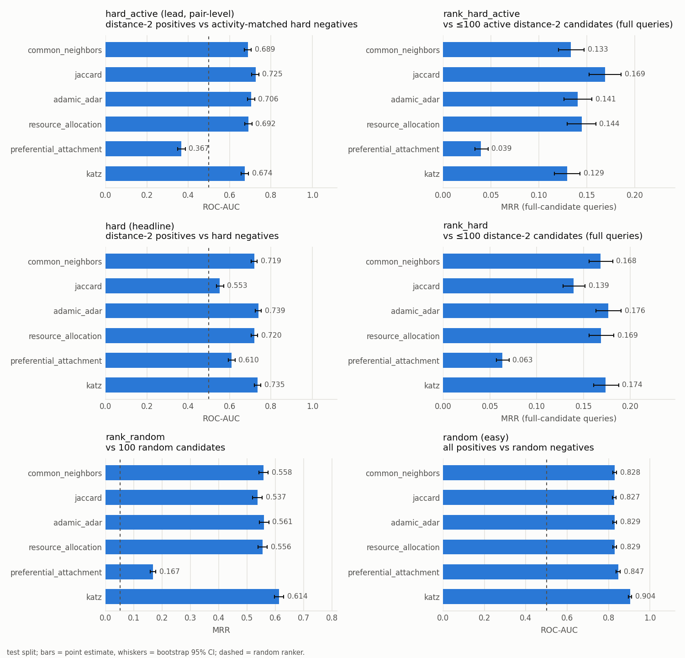
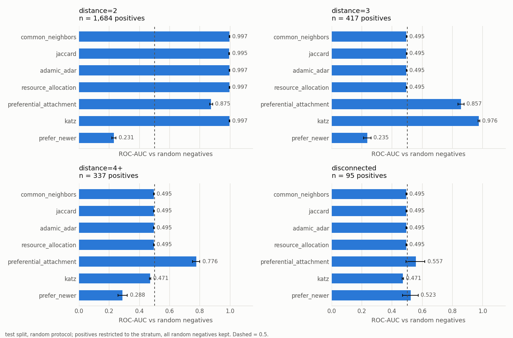
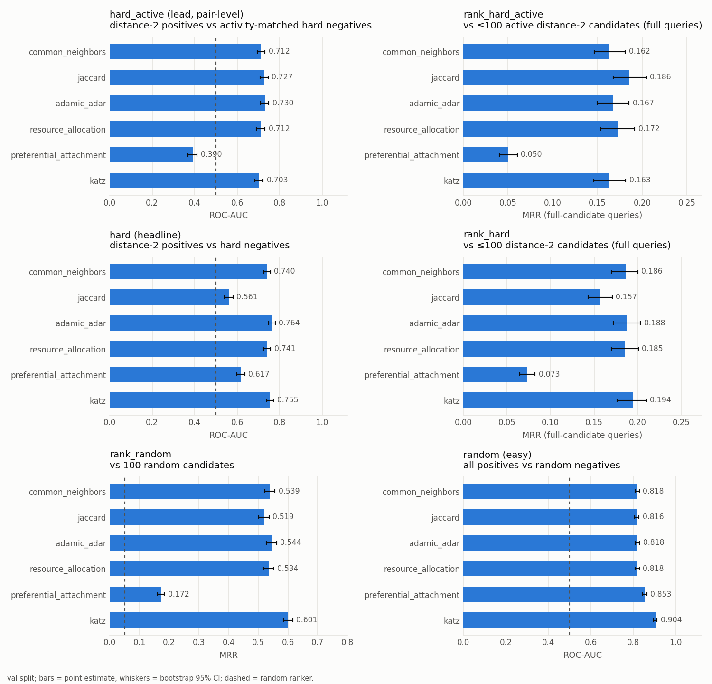

# Heuristic baselines

_Generated by `scripts/run_baselines.py` from `results/baselines.csv`, `results/baselines_paired.csv` and `results/katz_beta_selection.csv`. Values: point estimate [bootstrap 95% CI, 1,000 resamples]._

Truncated Katz uses beta = 0.005, chosen on validation (hard protocol, ROC-AUC); see the selection table at the end.

Ranking metrics use expected ranks under random tie-breaking (see `linkpred.eval.metrics`). A random ranker scores MRR ≈ 0.051 with 100 candidates; query_auc 0.5.

**Reading guide.** Neighbourhood heuristics (CN, Jaccard, Adamic-Adar, resource allocation) score every pair without a common neighbour exactly 0. Almost no random negative or random ranking candidate has a common neighbour, so under `random` and `rank_random` these heuristics essentially test *whether a positive is at distance 2*; the stratum table below shows near-perfect separation at distance 2 and chance (all ties) beyond it. `hard` and `rank_hard` remove that shortcut by comparing distance-2 pairs only. `hard_active` / `rank_hard_active` further restrict negatives to authors who publish in the prediction year, removing the activity shortcut (Phase 4); they are the lead pair-level numbers.

## Test split

### hard_active — all (n = 1,684)

| model | roc_auc | average_precision |
|---|---|---|
| common_neighbors | 0.689 [0.672, 0.705] | 0.663 [0.644, 0.683] |
| jaccard | 0.725 [0.707, 0.741] | 0.724 [0.704, 0.742] |
| adamic_adar | 0.706 [0.688, 0.722] | 0.706 [0.687, 0.727] |
| resource_allocation | 0.692 [0.674, 0.708] | 0.698 [0.678, 0.718] |
| preferential_attachment | 0.367 [0.348, 0.386] | 0.423 [0.411, 0.437] |
| katz | 0.674 [0.656, 0.691] | 0.681 [0.660, 0.702] |

### rank_hard_active — full_candidates (n = 895)

| model | hits@10 | hits@20 | hits@50 | mrr | query_auc |
|---|---|---|---|---|---|
| common_neighbors | 0.327 [0.297, 0.355] | 0.528 [0.499, 0.557] | 0.781 [0.758, 0.805] | 0.133 [0.120, 0.147] | 0.716 [0.698, 0.733] |
| jaccard | 0.382 [0.352, 0.413] | 0.583 [0.549, 0.613] | 0.823 [0.797, 0.848] | 0.169 [0.152, 0.186] | 0.752 [0.736, 0.768] |
| adamic_adar | 0.346 [0.314, 0.375] | 0.532 [0.500, 0.565] | 0.788 [0.760, 0.814] | 0.141 [0.126, 0.155] | 0.721 [0.702, 0.740] |
| resource_allocation | 0.344 [0.313, 0.377] | 0.515 [0.486, 0.547] | 0.749 [0.719, 0.775] | 0.144 [0.129, 0.159] | 0.702 [0.683, 0.722] |
| preferential_attachment | 0.061 [0.048, 0.078] | 0.142 [0.120, 0.165] | 0.363 [0.335, 0.395] | 0.039 [0.033, 0.047] | 0.401 [0.381, 0.421] |
| katz | 0.322 [0.289, 0.352] | 0.530 [0.497, 0.561] | 0.781 [0.755, 0.807] | 0.129 [0.116, 0.143] | 0.717 [0.698, 0.735] |

### rank_hard_active — partial_candidates (n = 787)

| model | hits@10 | hits@20 | hits@50 | mrr | query_auc |
|---|---|---|---|---|---|
| common_neighbors | 0.519 [0.489, 0.550] | 0.703 [0.676, 0.730] | 0.927 [0.914, 0.940] | 0.235 [0.216, 0.255] | 0.678 [0.661, 0.695] |
| jaccard | 0.528 [0.493, 0.562] | 0.719 [0.687, 0.750] | 0.947 [0.931, 0.962] | 0.276 [0.254, 0.299] | 0.717 [0.697, 0.738] |
| adamic_adar | 0.543 [0.510, 0.575] | 0.711 [0.681, 0.740] | 0.927 [0.909, 0.944] | 0.249 [0.228, 0.271] | 0.682 [0.663, 0.702] |
| resource_allocation | 0.525 [0.493, 0.559] | 0.706 [0.677, 0.736] | 0.922 [0.905, 0.939] | 0.248 [0.228, 0.271] | 0.672 [0.652, 0.692] |
| preferential_attachment | 0.189 [0.163, 0.215] | 0.363 [0.331, 0.397] | 0.744 [0.713, 0.770] | 0.082 [0.072, 0.093] | 0.351 [0.332, 0.373] |
| katz | 0.535 [0.502, 0.570] | 0.714 [0.681, 0.745] | 0.929 [0.913, 0.947] | 0.249 [0.228, 0.271] | 0.690 [0.671, 0.713] |

### rank_hard_active — all (n = 1,682)

| model | query_auc |
|---|---|
| common_neighbors | 0.698 [0.685, 0.710] |
| jaccard | 0.736 [0.723, 0.748] |
| adamic_adar | 0.703 [0.689, 0.716] |
| resource_allocation | 0.688 [0.675, 0.702] |
| preferential_attachment | 0.378 [0.363, 0.392] |
| katz | 0.704 [0.690, 0.718] |

### hard — all (n = 1,684)

| model | roc_auc | average_precision |
|---|---|---|
| common_neighbors | 0.719 [0.705, 0.734] | 0.619 [0.600, 0.638] |
| jaccard | 0.553 [0.536, 0.571] | 0.442 [0.426, 0.458] |
| adamic_adar | 0.739 [0.723, 0.754] | 0.671 [0.650, 0.691] |
| resource_allocation | 0.720 [0.703, 0.736] | 0.640 [0.617, 0.662] |
| preferential_attachment | 0.610 [0.594, 0.626] | 0.503 [0.485, 0.524] |
| katz | 0.735 [0.719, 0.751] | 0.664 [0.644, 0.684] |

### rank_hard — full_candidates (n = 1,377)

| model | hits@10 | hits@20 | hits@50 | mrr | query_auc |
|---|---|---|---|---|---|
| common_neighbors | 0.390 [0.366, 0.414] | 0.562 [0.537, 0.587] | 0.786 [0.768, 0.803] | 0.168 [0.156, 0.181] | 0.730 [0.716, 0.743] |
| jaccard | 0.319 [0.294, 0.345] | 0.484 [0.458, 0.511] | 0.709 [0.685, 0.732] | 0.139 [0.128, 0.152] | 0.674 [0.657, 0.689] |
| adamic_adar | 0.398 [0.372, 0.424] | 0.570 [0.542, 0.595] | 0.797 [0.775, 0.818] | 0.176 [0.163, 0.190] | 0.737 [0.722, 0.751] |
| resource_allocation | 0.382 [0.356, 0.407] | 0.537 [0.509, 0.563] | 0.770 [0.747, 0.791] | 0.169 [0.156, 0.182] | 0.720 [0.705, 0.734] |
| preferential_attachment | 0.142 [0.123, 0.161] | 0.269 [0.247, 0.293] | 0.591 [0.567, 0.617] | 0.063 [0.057, 0.070] | 0.557 [0.542, 0.574] |
| katz | 0.407 [0.381, 0.431] | 0.580 [0.554, 0.606] | 0.820 [0.800, 0.840] | 0.174 [0.161, 0.187] | 0.754 [0.739, 0.768] |

### rank_hard — partial_candidates (n = 307)

| model | hits@10 | hits@20 | hits@50 | mrr | query_auc |
|---|---|---|---|---|---|
| common_neighbors | 0.538 [0.488, 0.585] | 0.707 [0.666, 0.749] | 0.917 [0.897, 0.937] | 0.251 [0.218, 0.285] | 0.672 [0.648, 0.699] |
| jaccard | 0.417 [0.359, 0.469] | 0.621 [0.567, 0.675] | 0.879 [0.844, 0.915] | 0.194 [0.165, 0.227] | 0.583 [0.547, 0.621] |
| adamic_adar | 0.544 [0.491, 0.597] | 0.715 [0.669, 0.761] | 0.921 [0.898, 0.944] | 0.259 [0.226, 0.294] | 0.674 [0.645, 0.707] |
| resource_allocation | 0.512 [0.461, 0.564] | 0.693 [0.645, 0.743] | 0.918 [0.893, 0.942] | 0.253 [0.219, 0.289] | 0.664 [0.634, 0.693] |
| preferential_attachment | 0.332 [0.285, 0.386] | 0.537 [0.482, 0.590] | 0.890 [0.853, 0.923] | 0.124 [0.104, 0.146] | 0.532 [0.498, 0.563] |
| katz | 0.589 [0.533, 0.643] | 0.745 [0.696, 0.792] | 0.934 [0.906, 0.960] | 0.291 [0.253, 0.330] | 0.721 [0.690, 0.750] |

### rank_hard — all (n = 1,684)

| model | query_auc |
|---|---|
| common_neighbors | 0.720 [0.707, 0.732] |
| jaccard | 0.657 [0.641, 0.671] |
| adamic_adar | 0.726 [0.712, 0.738] |
| resource_allocation | 0.710 [0.696, 0.723] |
| preferential_attachment | 0.552 [0.537, 0.566] |
| katz | 0.748 [0.735, 0.761] |

### rank_random — all (n = 2,533)

| model | hits@20 | hits@50 | hits@100 | mrr | query_auc |
|---|---|---|---|---|---|
| common_neighbors | 0.727 [0.712, 0.741] | 0.828 [0.819, 0.838] | 0.997 [0.996, 0.997] | 0.558 [0.542, 0.575] | 0.826 [0.817, 0.835] |
| jaccard | 0.727 [0.712, 0.741] | 0.828 [0.819, 0.838] | 0.997 [0.996, 0.997] | 0.537 [0.520, 0.554] | 0.825 [0.816, 0.834] |
| adamic_adar | 0.727 [0.712, 0.741] | 0.828 [0.819, 0.838] | 0.997 [0.996, 0.997] | 0.561 [0.544, 0.578] | 0.826 [0.817, 0.835] |
| resource_allocation | 0.727 [0.712, 0.741] | 0.828 [0.819, 0.838] | 0.997 [0.996, 0.997] | 0.556 [0.539, 0.572] | 0.826 [0.816, 0.835] |
| preferential_attachment | 0.535 [0.515, 0.554] | 0.812 [0.797, 0.826] | 0.999 [0.999, 1.000] | 0.167 [0.157, 0.177] | 0.742 [0.732, 0.751] |
| katz | 0.849 [0.836, 0.862] | 0.906 [0.898, 0.914] | 0.998 [0.998, 0.998] | 0.614 [0.597, 0.630] | 0.896 [0.888, 0.903] |

### random — all (n = 2,533)

| model | roc_auc | average_precision |
|---|---|---|
| common_neighbors | 0.828 [0.820, 0.838] | 0.826 [0.816, 0.835] |
| jaccard | 0.827 [0.818, 0.837] | 0.823 [0.813, 0.833] |
| adamic_adar | 0.829 [0.820, 0.839] | 0.827 [0.818, 0.837] |
| resource_allocation | 0.829 [0.820, 0.839] | 0.828 [0.818, 0.837] |
| preferential_attachment | 0.847 [0.836, 0.857] | 0.846 [0.834, 0.857] |
| katz | 0.904 [0.895, 0.912] | 0.904 [0.896, 0.912] |

## Val split

### hard_active — all (n = 1,432)

| model | roc_auc | average_precision |
|---|---|---|
| common_neighbors | 0.712 [0.694, 0.731] | 0.683 [0.662, 0.703] |
| jaccard | 0.727 [0.708, 0.746] | 0.739 [0.719, 0.758] |
| adamic_adar | 0.730 [0.711, 0.749] | 0.725 [0.703, 0.747] |
| resource_allocation | 0.712 [0.691, 0.730] | 0.715 [0.693, 0.735] |
| preferential_attachment | 0.390 [0.369, 0.411] | 0.445 [0.430, 0.461] |
| katz | 0.703 [0.683, 0.722] | 0.706 [0.683, 0.729] |

### rank_hard_active — full_candidates (n = 752)

| model | hits@10 | hits@20 | hits@50 | mrr | query_auc |
|---|---|---|---|---|---|
| common_neighbors | 0.384 [0.351, 0.416] | 0.566 [0.531, 0.599] | 0.802 [0.775, 0.827] | 0.162 [0.146, 0.181] | 0.738 [0.718, 0.756] |
| jaccard | 0.416 [0.381, 0.452] | 0.588 [0.552, 0.622] | 0.842 [0.815, 0.868] | 0.186 [0.168, 0.205] | 0.766 [0.747, 0.783] |
| adamic_adar | 0.394 [0.357, 0.425] | 0.592 [0.554, 0.627] | 0.822 [0.794, 0.849] | 0.167 [0.150, 0.185] | 0.752 [0.732, 0.770] |
| resource_allocation | 0.386 [0.351, 0.417] | 0.546 [0.509, 0.582] | 0.804 [0.776, 0.831] | 0.172 [0.153, 0.192] | 0.740 [0.719, 0.758] |
| preferential_attachment | 0.072 [0.055, 0.090] | 0.151 [0.126, 0.177] | 0.339 [0.303, 0.374] | 0.050 [0.040, 0.060] | 0.392 [0.369, 0.413] |
| katz | 0.371 [0.336, 0.404] | 0.560 [0.523, 0.596] | 0.789 [0.757, 0.816] | 0.163 [0.146, 0.182] | 0.735 [0.713, 0.753] |

### rank_hard_active — partial_candidates (n = 679)

| model | hits@10 | hits@20 | hits@50 | mrr | query_auc |
|---|---|---|---|---|---|
| common_neighbors | 0.511 [0.476, 0.544] | 0.696 [0.665, 0.726] | 0.924 [0.908, 0.939] | 0.235 [0.215, 0.256] | 0.677 [0.658, 0.698] |
| jaccard | 0.539 [0.505, 0.575] | 0.728 [0.696, 0.760] | 0.953 [0.937, 0.968] | 0.256 [0.232, 0.280] | 0.710 [0.690, 0.730] |
| adamic_adar | 0.512 [0.475, 0.547] | 0.687 [0.652, 0.718] | 0.931 [0.912, 0.947] | 0.242 [0.221, 0.264] | 0.677 [0.654, 0.699] |
| resource_allocation | 0.501 [0.464, 0.538] | 0.663 [0.629, 0.697] | 0.926 [0.906, 0.943] | 0.241 [0.220, 0.264] | 0.663 [0.640, 0.686] |
| preferential_attachment | 0.191 [0.161, 0.220] | 0.389 [0.350, 0.423] | 0.727 [0.695, 0.762] | 0.088 [0.077, 0.101] | 0.380 [0.357, 0.404] |
| katz | 0.518 [0.479, 0.555] | 0.715 [0.680, 0.750] | 0.927 [0.907, 0.946] | 0.241 [0.220, 0.262] | 0.691 [0.668, 0.714] |

### rank_hard_active — all (n = 1,431)

| model | query_auc |
|---|---|
| common_neighbors | 0.709 [0.695, 0.723] |
| jaccard | 0.739 [0.725, 0.753] |
| adamic_adar | 0.716 [0.702, 0.731] |
| resource_allocation | 0.703 [0.688, 0.718] |
| preferential_attachment | 0.386 [0.370, 0.404] |
| katz | 0.714 [0.700, 0.729] |

### hard — all (n = 1,432)

| model | roc_auc | average_precision |
|---|---|---|
| common_neighbors | 0.740 [0.726, 0.756] | 0.640 [0.620, 0.660] |
| jaccard | 0.561 [0.541, 0.580] | 0.440 [0.423, 0.461] |
| adamic_adar | 0.764 [0.747, 0.779] | 0.695 [0.674, 0.717] |
| resource_allocation | 0.741 [0.725, 0.758] | 0.659 [0.636, 0.682] |
| preferential_attachment | 0.617 [0.599, 0.636] | 0.509 [0.489, 0.532] |
| katz | 0.755 [0.739, 0.771] | 0.686 [0.665, 0.708] |

### rank_hard — full_candidates (n = 1,152)

| model | hits@10 | hits@20 | hits@50 | mrr | query_auc |
|---|---|---|---|---|---|
| common_neighbors | 0.425 [0.396, 0.451] | 0.590 [0.562, 0.616] | 0.799 [0.779, 0.818] | 0.186 [0.170, 0.200] | 0.746 [0.732, 0.762] |
| jaccard | 0.357 [0.329, 0.384] | 0.497 [0.468, 0.523] | 0.733 [0.706, 0.760] | 0.157 [0.143, 0.171] | 0.691 [0.673, 0.709] |
| adamic_adar | 0.438 [0.408, 0.466] | 0.604 [0.575, 0.630] | 0.824 [0.803, 0.846] | 0.188 [0.172, 0.203] | 0.761 [0.747, 0.777] |
| resource_allocation | 0.418 [0.389, 0.446] | 0.572 [0.541, 0.598] | 0.809 [0.787, 0.830] | 0.185 [0.170, 0.201] | 0.748 [0.733, 0.764] |
| preferential_attachment | 0.157 [0.135, 0.178] | 0.273 [0.247, 0.298] | 0.569 [0.541, 0.599] | 0.073 [0.065, 0.082] | 0.559 [0.543, 0.576] |
| katz | 0.432 [0.403, 0.461] | 0.607 [0.578, 0.635] | 0.820 [0.796, 0.842] | 0.194 [0.176, 0.210] | 0.764 [0.749, 0.779] |

### rank_hard — partial_candidates (n = 280)

| model | hits@10 | hits@20 | hits@50 | mrr | query_auc |
|---|---|---|---|---|---|
| common_neighbors | 0.498 [0.446, 0.547] | 0.657 [0.609, 0.702] | 0.896 [0.871, 0.918] | 0.250 [0.216, 0.285] | 0.665 [0.633, 0.694] |
| jaccard | 0.340 [0.287, 0.393] | 0.522 [0.468, 0.576] | 0.855 [0.818, 0.893] | 0.173 [0.144, 0.209] | 0.564 [0.530, 0.598] |
| adamic_adar | 0.509 [0.454, 0.563] | 0.655 [0.600, 0.704] | 0.864 [0.828, 0.899] | 0.255 [0.220, 0.289] | 0.648 [0.610, 0.685] |
| resource_allocation | 0.482 [0.423, 0.535] | 0.619 [0.566, 0.668] | 0.861 [0.824, 0.895] | 0.252 [0.216, 0.286] | 0.633 [0.596, 0.668] |
| preferential_attachment | 0.273 [0.225, 0.329] | 0.483 [0.427, 0.536] | 0.813 [0.767, 0.858] | 0.119 [0.094, 0.145] | 0.542 [0.509, 0.573] |
| katz | 0.563 [0.510, 0.624] | 0.718 [0.664, 0.771] | 0.948 [0.922, 0.971] | 0.273 [0.233, 0.312] | 0.715 [0.681, 0.749] |

### rank_hard — all (n = 1,432)

| model | query_auc |
|---|---|
| common_neighbors | 0.731 [0.717, 0.744] |
| jaccard | 0.666 [0.649, 0.683] |
| adamic_adar | 0.739 [0.724, 0.754] |
| resource_allocation | 0.725 [0.710, 0.741] |
| preferential_attachment | 0.556 [0.541, 0.571] |
| katz | 0.755 [0.741, 0.768] |

### rank_random — all (n = 2,225)

| model | hits@20 | hits@50 | hits@100 | mrr | query_auc |
|---|---|---|---|---|---|
| common_neighbors | 0.710 [0.693, 0.726] | 0.817 [0.807, 0.828] | 0.996 [0.996, 0.997] | 0.539 [0.521, 0.556] | 0.815 [0.805, 0.825] |
| jaccard | 0.710 [0.693, 0.726] | 0.817 [0.807, 0.828] | 0.996 [0.996, 0.997] | 0.519 [0.501, 0.536] | 0.815 [0.805, 0.825] |
| adamic_adar | 0.710 [0.693, 0.726] | 0.817 [0.807, 0.828] | 0.996 [0.996, 0.997] | 0.544 [0.526, 0.561] | 0.815 [0.805, 0.826] |
| resource_allocation | 0.710 [0.693, 0.726] | 0.817 [0.807, 0.828] | 0.996 [0.996, 0.997] | 0.534 [0.517, 0.551] | 0.815 [0.805, 0.825] |
| preferential_attachment | 0.541 [0.520, 0.559] | 0.813 [0.796, 0.828] | 0.998 [0.998, 0.999] | 0.172 [0.162, 0.184] | 0.747 [0.737, 0.757] |
| katz | 0.849 [0.835, 0.863] | 0.907 [0.898, 0.915] | 0.998 [0.998, 0.998] | 0.601 [0.584, 0.616] | 0.896 [0.887, 0.904] |

### random — all (n = 2,225)

| model | roc_auc | average_precision |
|---|---|---|
| common_neighbors | 0.818 [0.808, 0.828] | 0.818 [0.808, 0.827] |
| jaccard | 0.816 [0.806, 0.826] | 0.811 [0.800, 0.822] |
| adamic_adar | 0.818 [0.808, 0.829] | 0.819 [0.810, 0.829] |
| resource_allocation | 0.818 [0.808, 0.828] | 0.818 [0.808, 0.828] |
| preferential_attachment | 0.853 [0.842, 0.864] | 0.855 [0.843, 0.867] |
| katz | 0.904 [0.896, 0.912] | 0.906 [0.897, 0.914] |

## Random protocol by positive stratum (test, ROC-AUC)

Positives restricted to the stratum; all random negatives kept.

| model | distance=2 (n=1,684) | distance=3 (n=417) | distance=4+ (n=337) | disconnected (n=95) | cold_start (n=970) | established (n=1,563) |
|---|---|---|---|---|---|---|
| common_neighbors | 0.997 [0.995, 0.998] | 0.495 [0.493, 0.497] | 0.495 [0.493, 0.497] | 0.495 [0.493, 0.497] | 0.797 [0.782, 0.813] | 0.848 [0.836, 0.859] |
| jaccard | 0.995 [0.992, 0.997] | 0.495 [0.493, 0.497] | 0.495 [0.493, 0.497] | 0.495 [0.493, 0.497] | 0.797 [0.782, 0.813] | 0.846 [0.834, 0.857] |
| adamic_adar | 0.997 [0.995, 0.998] | 0.495 [0.493, 0.497] | 0.495 [0.493, 0.497] | 0.495 [0.493, 0.497] | 0.797 [0.783, 0.813] | 0.848 [0.836, 0.859] |
| resource_allocation | 0.997 [0.995, 0.998] | 0.495 [0.493, 0.497] | 0.495 [0.493, 0.497] | 0.495 [0.493, 0.497] | 0.797 [0.783, 0.813] | 0.848 [0.836, 0.859] |
| preferential_attachment | 0.875 [0.865, 0.885] | 0.857 [0.837, 0.876] | 0.776 [0.751, 0.801] | 0.557 [0.492, 0.618] | 0.730 [0.711, 0.746] | 0.919 [0.911, 0.928] |
| katz | 0.997 [0.995, 0.998] | 0.976 [0.971, 0.981] | 0.471 [0.466, 0.475] | 0.471 [0.466, 0.475] | 0.866 [0.851, 0.880] | 0.927 [0.918, 0.936] |

## Hard protocol by cold start (test, ROC-AUC)

| model | cold_start (n=585) | established (n=1,099) |
|---|---|---|
| common_neighbors | 0.656 [0.632, 0.679] | 0.753 [0.736, 0.771] |
| jaccard | 0.613 [0.585, 0.638] | 0.521 [0.499, 0.541] |
| adamic_adar | 0.675 [0.648, 0.700] | 0.773 [0.754, 0.790] |
| resource_allocation | 0.666 [0.639, 0.692] | 0.749 [0.730, 0.767] |
| preferential_attachment | 0.406 [0.383, 0.429] | 0.718 [0.700, 0.736] |
| katz | 0.650 [0.623, 0.676] | 0.780 [0.763, 0.797] |

## Paired bootstrap tests (test)

Validation-best heuristic per protocol (by its headline metric) minus each other heuristic, same test pairs; p-values are two-sided, floored at 0.001.

| protocol | subset | metric | model | difference [95% CI] | p |
|---|---|---|---|---|---|
| hard | all | roc_auc_diff | adamic_adar - common_neighbors | 0.019 [0.012, 0.026] | 0.001 |
| hard | all | roc_auc_diff | adamic_adar - jaccard | 0.186 [0.167, 0.206] | 0.001 |
| hard | all | roc_auc_diff | adamic_adar - resource_allocation | 0.019 [0.012, 0.026] | 0.001 |
| hard | all | roc_auc_diff | adamic_adar - preferential_attachment | 0.129 [0.109, 0.148] | 0.001 |
| hard | all | roc_auc_diff | adamic_adar - katz | 0.004 [-0.007, 0.015] | 0.454 |
| rank_random | all | mrr_diff | katz - common_neighbors | 0.055 [0.048, 0.063] | 0.001 |
| rank_random | all | mrr_diff | katz - jaccard | 0.077 [0.067, 0.087] | 0.001 |
| rank_random | all | mrr_diff | katz - adamic_adar | 0.053 [0.045, 0.062] | 0.001 |
| rank_random | all | mrr_diff | katz - resource_allocation | 0.058 [0.049, 0.068] | 0.001 |
| rank_random | all | mrr_diff | katz - preferential_attachment | 0.447 [0.428, 0.464] | 0.001 |
| rank_hard | full_candidates | mrr_diff | katz - common_neighbors | 0.005 [0.001, 0.010] | 0.026 |
| rank_hard | full_candidates | mrr_diff | katz - jaccard | 0.034 [0.021, 0.048] | 0.001 |
| rank_hard | full_candidates | mrr_diff | katz - adamic_adar | -0.003 [-0.010, 0.004] | 0.438 |
| rank_hard | full_candidates | mrr_diff | katz - resource_allocation | 0.005 [-0.005, 0.016] | 0.364 |
| rank_hard | full_candidates | mrr_diff | katz - preferential_attachment | 0.110 [0.098, 0.123] | 0.001 |
| random | all | roc_auc_diff | katz - common_neighbors | 0.075 [0.069, 0.082] | 0.001 |
| random | all | roc_auc_diff | katz - jaccard | 0.077 [0.070, 0.084] | 0.001 |
| random | all | roc_auc_diff | katz - adamic_adar | 0.075 [0.068, 0.082] | 0.001 |
| random | all | roc_auc_diff | katz - resource_allocation | 0.075 [0.069, 0.082] | 0.001 |
| random | all | roc_auc_diff | katz - preferential_attachment | 0.057 [0.046, 0.068] | 0.001 |
| diagnostic_all_vs_hard | all | roc_auc_diff | preferential_attachment - common_neighbors | 0.090 [0.071, 0.110] | 0.001 |
| diagnostic_all_vs_hard | all | roc_auc_diff | preferential_attachment - jaccard | 0.201 [0.176, 0.227] | 0.001 |
| diagnostic_all_vs_hard | all | roc_auc_diff | preferential_attachment - adamic_adar | 0.077 [0.057, 0.097] | 0.001 |
| diagnostic_all_vs_hard | all | roc_auc_diff | preferential_attachment - resource_allocation | 0.090 [0.069, 0.110] | 0.001 |
| diagnostic_all_vs_hard | all | roc_auc_diff | preferential_attachment - katz | 0.080 [0.062, 0.098] | 0.001 |
| hard_active | all | roc_auc_diff | adamic_adar - common_neighbors | 0.016 [0.010, 0.024] | 0.001 |
| hard_active | all | roc_auc_diff | adamic_adar - jaccard | -0.020 [-0.038, -0.002] | 0.034 |
| hard_active | all | roc_auc_diff | adamic_adar - resource_allocation | 0.014 [0.006, 0.022] | 0.002 |
| hard_active | all | roc_auc_diff | adamic_adar - preferential_attachment | 0.339 [0.318, 0.361] | 0.001 |
| hard_active | all | roc_auc_diff | adamic_adar - katz | 0.031 [0.021, 0.043] | 0.001 |
| rank_hard_active | full_candidates | mrr_diff | jaccard - common_neighbors | 0.036 [0.021, 0.050] | 0.001 |
| rank_hard_active | full_candidates | mrr_diff | jaccard - adamic_adar | 0.028 [0.014, 0.043] | 0.001 |
| rank_hard_active | full_candidates | mrr_diff | jaccard - resource_allocation | 0.024 [0.008, 0.040] | 0.002 |
| rank_hard_active | full_candidates | mrr_diff | jaccard - preferential_attachment | 0.129 [0.111, 0.149] | 0.001 |
| rank_hard_active | full_candidates | mrr_diff | jaccard - katz | 0.040 [0.023, 0.055] | 0.001 |

## Appendix: diagnostic_all_vs_hard

> **Warning — diagnostic only, not a result.** All hard negatives are at distance 2, while 34–41% of positives are at distance ≥ 3, so in this comparison distance alone separates the classes. A learned model that picks up distance (or anything correlated with it) can look good here for the wrong reason; neighbourhood heuristics are pushed the other way, because they score every distance-3+ positive 0, below every hard negative. Neither direction says anything about the task. Use `hard` instead.

### test

| model | roc_auc | average_precision |
|---|---|---|
| common_neighbors | 0.478 [0.462, 0.496] | 0.579 [0.565, 0.594] |
| jaccard | 0.367 [0.353, 0.383] | 0.461 [0.450, 0.474] |
| adamic_adar | 0.491 [0.474, 0.509] | 0.614 [0.598, 0.630] |
| resource_allocation | 0.479 [0.462, 0.496] | 0.593 [0.578, 0.609] |
| preferential_attachment | 0.568 [0.553, 0.585] | 0.564 [0.550, 0.580] |
| katz | 0.489 [0.472, 0.506] | 0.598 [0.582, 0.614] |

### val

| model | roc_auc | average_precision |
|---|---|---|
| common_neighbors | 0.476 [0.459, 0.495] | 0.590 [0.576, 0.606] |
| jaccard | 0.361 [0.345, 0.378] | 0.461 [0.450, 0.475] |
| adamic_adar | 0.491 [0.473, 0.510] | 0.626 [0.610, 0.643] |
| resource_allocation | 0.477 [0.459, 0.495] | 0.602 [0.586, 0.619] |
| preferential_attachment | 0.571 [0.553, 0.588] | 0.569 [0.553, 0.587] |
| katz | 0.486 [0.468, 0.505] | 0.606 [0.589, 0.624] |

## Katz beta selection (validation, hard protocol)

| model | average_precision | roc_auc |
|---|---|---|
| katz_beta=0.0001 | 0.6843 | 0.7548 |
| katz_beta=0.001 | 0.6845 | 0.7548 |
| katz_beta=0.005 | 0.6859 | 0.7551 |
| katz_beta=0.01 | 0.6857 | 0.7549 |
| katz_beta=0.05 | 0.6733 | 0.7466 |
| katz_beta=0.1 | 0.6661 | 0.7407 |
| katz_beta=0.5 | 0.6565 | 0.731 |

## Figures

