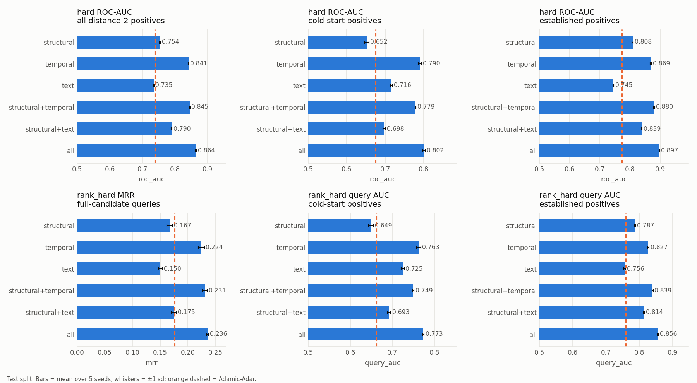
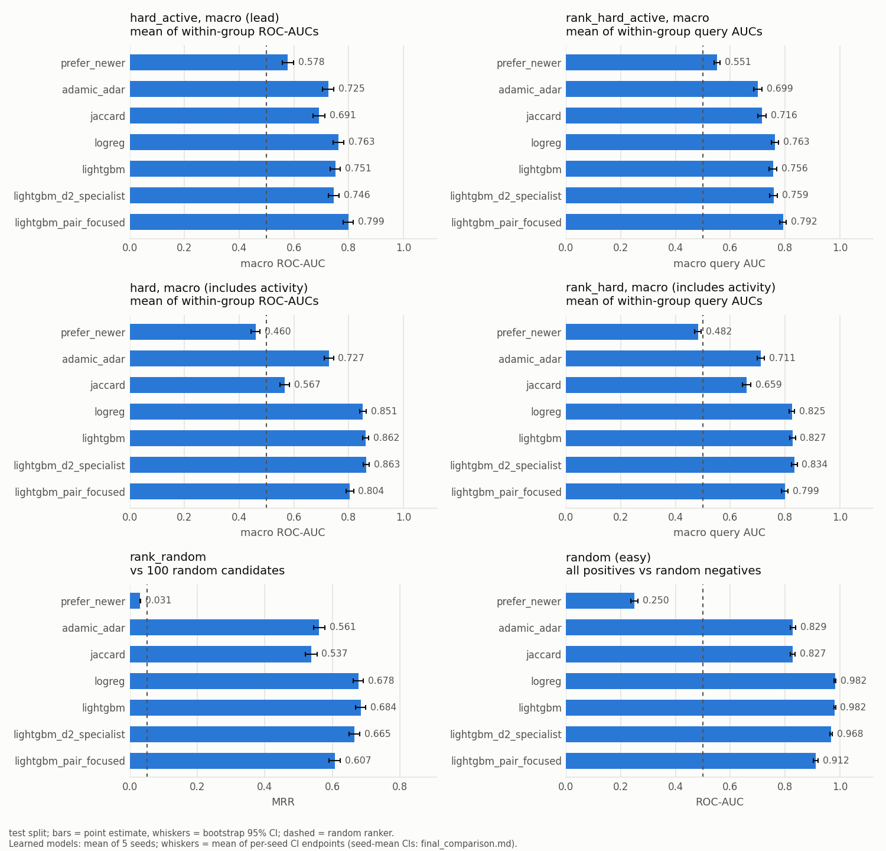

# Feature-based models (logistic regression, LightGBM)

_Generated by `scripts/run_feature_models.py` from `results/feature_models.csv`, `feature_models_paired.csv`, `negative_mix_grid.csv`, `lgbm_search.csv`, `ablation.csv`, `half_life_selection.csv`. Learned models: mean ± sd of the point estimate over 5 seeds (logistic regression is deterministic, so its sd is 0). Reference rows (Adamic-Adar, Jaccard, Katz, prefer_newer): point estimate [bootstrap 95% CI] from `results/baselines.csv`. Seed-mean confidence intervals and the multiplicity-corrected primary tests are in `results/final_comparison.md`._

**How to read this.** Headline numbers are **macro within-group** scores: positives and negatives are compared inside the established and newcomer groups separately and averaged (audit M2). `hard_active` is the lead pair-level protocol; `hard` keeps negatives with inactive authors and therefore *includes activity*. Pooled numbers are kept but are affected by the newcomer imbalance. `prefer_newer` is a reference that only prefers pairs with a newer author. **`lightgbm_pair_focused` is the retrained model (distance-2 positives only, audit M1);** the pre-audit version is in the appendix as `lightgbm_pair_focused_shortcut`.

## Choices made on validation

- Negative mix: logistic regression **hard fraction 0, 1:1**; LightGBM **hard fraction 0, 1:3** (rule: best val pooled `hard` ROC-AUC among mixes with val rank_random MRR ≥ 90% of the best mix).
- LightGBM: num_leaves 7, learning_rate 0.03, min_child_samples 100, subsample 0.8, colsample_bytree 0.8; early stopping on val hard AP.
- Pair-focused LightGBM (distance-2 positives vs 2023 activity-matched negatives): num_leaves 2, learning_rate 0.1, min_child_samples 20; early stopping on val hard_active AP, selected by val pooled hard_active ROC-AUC.
- Pair-focused LightGBM with the distance shortcut (appendix): num_leaves 7, learning_rate 0.03, min_child_samples 20; early stopping on val hard_active AP, selected by val pooled hard_active ROC-AUC.
- Recency half-life: 2 years (val hard ROC-AUC of recency-weighted Adamic-Adar alone).
- Validation-best heuristic per protocol (paired-test reference, prefer_newer excluded): hard_active: adamic_adar, rank_hard_active: jaccard, hard: adamic_adar, rank_hard: katz, rank_random: katz, random: katz; Adamic-Adar is also tested on the pair-level protocols.

## Embedding coverage (authors with ≥ 1 embedded work before the cutoff)

| split | nodes | share_nodes_with_text | share_uts_nodes_with_text | share_nodes_with_abstract | share_uts_nodes_with_abstract |
|---|---|---|---|---|---|
| train | 75665 | 1.000 | 1.000 | 0.782 | 0.860 |
| val | 87607 | 1.000 | 1.000 | 0.787 | 0.861 |
| test | 99664 | 1.000 | 1.000 | 0.793 | 0.866 |

## Negative-mix grid (validation, seed 0, default LightGBM params)

Pooled metrics, as used by the selection rule.

| model | mix | hard_active ROC-AUC | hard ROC-AUC | hard AP | rank_hard MRR | rank_random MRR | random ROC-AUC |
|---|---|---|---|---|---|---|
| logreg|hard=0|1:1 | 0.7721 | 0.8514 | 0.7771 | 0.2374 | 0.6799 | 0.9827 |
| logreg|hard=0|1:3 | 0.7295 | 0.8493 | 0.7841 | 0.2225 | 0.6779 | 0.9829 |
| logreg|hard=0.5|1:1 | 0.7307 | 0.8479 | 0.7873 | 0.2384 | 0.4180 | 0.9425 |
| logreg|hard=0.5|1:3 | 0.7352 | 0.8510 | 0.7890 | 0.2352 | 0.3923 | 0.9359 |
| logreg|hard=1|1:1 | 0.7532 | 0.8670 | 0.8080 | 0.2463 | 0.0485 | 0.1207 |
| logreg|hard=1|1:3 | 0.7545 | 0.8683 | 0.8121 | 0.2523 | 0.0415 | 0.1145 |
| lightgbm|hard=0|1:1 | 0.7374 | 0.8354 | 0.7587 | 0.2034 | 0.6594 | 0.9802 |
| lightgbm|hard=0|1:3 | 0.7358 | 0.8552 | 0.7716 | 0.1891 | 0.6736 | 0.9820 |
| lightgbm|hard=0.5|1:1 | 0.7372 | 0.8555 | 0.7899 | 0.2248 | 0.3260 | 0.9459 |
| lightgbm|hard=0.5|1:3 | 0.7446 | 0.8608 | 0.7998 | 0.2308 | 0.3208 | 0.9487 |
| lightgbm|hard=1|1:1 | 0.7480 | 0.8621 | 0.8011 | 0.2288 | 0.0251 | 0.1867 |
| lightgbm|hard=1|1:3 | 0.7517 | 0.8624 | 0.8002 | 0.2276 | 0.0251 | 0.1868 |

## LightGBM searches (validation, chosen mix, seed 0)

| model | roc_auc | average_precision | n_trees |
|---|---|---|---|
| lightgbm|leaves=7|lr=0.03|min_child=100 | 0.862 | 0.7968 | 159.0 |
| lightgbm|leaves=15|lr=0.03|min_child=100 | 0.8617 | 0.7916 | 167.0 |
| lightgbm|leaves=3|lr=0.1|min_child=100 | 0.8599 | 0.8005 | 165.0 |
| lightgbm|leaves=7|lr=0.03|min_child=20 | 0.8598 | 0.7952 | 190.0 |
| lightgbm|leaves=15|lr=0.03|min_child=20 | 0.8592 | 0.7891 | 159.0 |
| lightgbm|leaves=3|lr=0.03|min_child=100 | 0.859 | 0.7979 | 592.0 |
| lightgbm|leaves=15|lr=0.1|min_child=20 | 0.8588 | 0.7872 | 41.0 |
| lightgbm|leaves=7|lr=0.1|min_child=100 | 0.8587 | 0.7931 | 71.0 |
| lightgbm|leaves=7|lr=0.1|min_child=20 | 0.8572 | 0.7892 | 54.0 |
| lightgbm|leaves=7|lr=0.1|min_child=300 | 0.8571 | 0.7968 | 68.0 |
| lightgbm|leaves=31|lr=0.03|min_child=20 | 0.8567 | 0.7799 | 113.0 |
| lightgbm|leaves=7|lr=0.03|min_child=300 | 0.8566 | 0.7964 | 289.0 |
| lightgbm|leaves=15|lr=0.1|min_child=300 | 0.8565 | 0.7874 | 61.0 |
| lightgbm|leaves=31|lr=0.03|min_child=100 | 0.8563 | 0.7819 | 179.0 |
| lightgbm|leaves=3|lr=0.1|min_child=300 | 0.856 | 0.796 | 209.0 |
| lightgbm|leaves=3|lr=0.03|min_child=300 | 0.8557 | 0.7944 | 594.0 |
| lightgbm|leaves=15|lr=0.1|min_child=100 | 0.8556 | 0.7811 | 62.0 |
| lightgbm|leaves=31|lr=0.1|min_child=100 | 0.8554 | 0.7808 | 43.0 |
| lightgbm|leaves=31|lr=0.1|min_child=300 | 0.8554 | 0.7874 | 70.0 |
| lightgbm|leaves=3|lr=0.1|min_child=20 | 0.8551 | 0.7937 | 72.0 |
| lightgbm|leaves=3|lr=0.03|min_child=20 | 0.8532 | 0.7881 | 309.0 |
| lightgbm|leaves=31|lr=0.03|min_child=300 | 0.8516 | 0.7742 | 6.0 |
| lightgbm|leaves=15|lr=0.03|min_child=300 | 0.8516 | 0.7742 | 6.0 |
| lightgbm|leaves=31|lr=0.1|min_child=20 | 0.8462 | 0.7725 | 52.0 |
| lightgbm_pair_focused|leaves=2|lr=0.1|min_child=20 | 0.8388 | 0.8254 | 178.0 |
| lightgbm_pair_focused|leaves=2|lr=0.1|min_child=100 | 0.8372 | 0.8245 | 184.0 |
| lightgbm_pair_focused|leaves=3|lr=0.03|min_child=300 | 0.8371 | 0.8309 | 378.0 |
| lightgbm_pair_focused|leaves=2|lr=0.1|min_child=300 | 0.837 | 0.8284 | 175.0 |
| lightgbm_pair_focused|leaves=2|lr=0.03|min_child=300 | 0.8367 | 0.8283 | 511.0 |
| lightgbm_pair_focused|leaves=3|lr=0.03|min_child=100 | 0.8364 | 0.8273 | 229.0 |
| lightgbm_pair_focused|leaves=3|lr=0.1|min_child=300 | 0.8363 | 0.8299 | 93.0 |
| lightgbm_pair_focused|leaves=3|lr=0.03|min_child=20 | 0.8362 | 0.8258 | 261.0 |
| lightgbm_pair_focused|leaves=3|lr=0.1|min_child=20 | 0.8362 | 0.8242 | 97.0 |
| lightgbm_pair_focused|leaves=7|lr=0.03|min_child=100 | 0.8361 | 0.8274 | 118.0 |
| lightgbm_pair_focused_shortcut|leaves=7|lr=0.03|min_child=20 | 0.836 | 0.8241 | 199.0 |
| lightgbm_pair_focused_shortcut|leaves=7|lr=0.03|min_child=100 | 0.8357 | 0.8245 | 199.0 |
| lightgbm_pair_focused|leaves=3|lr=0.1|min_child=100 | 0.8355 | 0.826 | 95.0 |
| lightgbm_pair_focused|leaves=7|lr=0.03|min_child=20 | 0.8354 | 0.8264 | 131.0 |
| lightgbm_pair_focused|leaves=2|lr=0.03|min_child=100 | 0.8353 | 0.8235 | 386.0 |
| lightgbm_pair_focused_shortcut|leaves=3|lr=0.1|min_child=100 | 0.8353 | 0.8245 | 129.0 |
| lightgbm_pair_focused|leaves=2|lr=0.03|min_child=20 | 0.8352 | 0.8229 | 358.0 |
| lightgbm_pair_focused_shortcut|leaves=7|lr=0.1|min_child=20 | 0.8351 | 0.8203 | 48.0 |
| lightgbm_pair_focused_shortcut|leaves=3|lr=0.03|min_child=20 | 0.8347 | 0.8232 | 301.0 |
| lightgbm_pair_focused_shortcut|leaves=3|lr=0.03|min_child=100 | 0.8347 | 0.8237 | 296.0 |
| lightgbm_pair_focused|leaves=15|lr=0.03|min_child=100 | 0.8344 | 0.8248 | 118.0 |
| lightgbm_pair_focused|leaves=7|lr=0.1|min_child=20 | 0.8343 | 0.8238 | 40.0 |
| lightgbm_pair_focused|leaves=7|lr=0.1|min_child=100 | 0.8342 | 0.8268 | 37.0 |
| lightgbm_pair_focused|leaves=3|lr=0.03|min_child=500 | 0.8342 | 0.8287 | 304.0 |
| lightgbm_pair_focused|leaves=15|lr=0.03|min_child=20 | 0.8342 | 0.8245 | 106.0 |
| lightgbm_pair_focused_shortcut|leaves=7|lr=0.03|min_child=300 | 0.834 | 0.8265 | 183.0 |
| lightgbm_pair_focused|leaves=2|lr=0.03|min_child=500 | 0.834 | 0.8267 | 596.0 |
| lightgbm_pair_focused|leaves=3|lr=0.1|min_child=500 | 0.8339 | 0.8282 | 99.0 |
| lightgbm_pair_focused_shortcut|leaves=3|lr=0.1|min_child=20 | 0.8338 | 0.8228 | 89.0 |
| lightgbm_pair_focused_shortcut|leaves=7|lr=0.1|min_child=100 | 0.8337 | 0.8233 | 45.0 |
| lightgbm_pair_focused_shortcut|leaves=3|lr=0.1|min_child=300 | 0.8337 | 0.8262 | 126.0 |
| lightgbm_pair_focused|leaves=2|lr=0.1|min_child=500 | 0.8335 | 0.826 | 234.0 |
| lightgbm_pair_focused_shortcut|leaves=3|lr=0.03|min_child=300 | 0.8333 | 0.8249 | 385.0 |
| lightgbm_pair_focused_shortcut|leaves=15|lr=0.03|min_child=20 | 0.8333 | 0.8196 | 98.0 |
| lightgbm_pair_focused|leaves=7|lr=0.03|min_child=300 | 0.833 | 0.8266 | 140.0 |
| lightgbm_pair_focused|leaves=15|lr=0.1|min_child=20 | 0.8325 | 0.8211 | 38.0 |
| lightgbm_pair_focused|leaves=7|lr=0.1|min_child=300 | 0.8323 | 0.827 | 53.0 |
| lightgbm_pair_focused_shortcut|leaves=7|lr=0.1|min_child=300 | 0.8321 | 0.8253 | 48.0 |
| lightgbm_pair_focused|leaves=15|lr=0.03|min_child=300 | 0.832 | 0.8264 | 138.0 |
| lightgbm_pair_focused|leaves=31|lr=0.03|min_child=300 | 0.832 | 0.8264 | 138.0 |
| lightgbm_pair_focused_shortcut|leaves=15|lr=0.03|min_child=300 | 0.8316 | 0.8249 | 145.0 |
| lightgbm_pair_focused_shortcut|leaves=15|lr=0.03|min_child=100 | 0.8315 | 0.821 | 84.0 |
| lightgbm_pair_focused|leaves=7|lr=0.03|min_child=500 | 0.8314 | 0.8258 | 181.0 |
| lightgbm_pair_focused_shortcut|leaves=15|lr=0.1|min_child=100 | 0.8312 | 0.8203 | 32.0 |
| lightgbm_pair_focused|leaves=31|lr=0.03|min_child=500 | 0.8311 | 0.8256 | 174.0 |
| lightgbm_pair_focused|leaves=15|lr=0.03|min_child=500 | 0.8311 | 0.8256 | 174.0 |
| lightgbm_pair_focused|leaves=7|lr=0.1|min_child=500 | 0.8311 | 0.8257 | 64.0 |
| lightgbm_pair_focused|leaves=15|lr=0.1|min_child=1000 | 0.8309 | 0.8253 | 162.0 |
| lightgbm_pair_focused|leaves=7|lr=0.1|min_child=1000 | 0.8309 | 0.8253 | 162.0 |
| lightgbm_pair_focused|leaves=31|lr=0.1|min_child=1000 | 0.8309 | 0.8253 | 162.0 |
| lightgbm_pair_focused|leaves=7|lr=0.03|min_child=1000 | 0.8308 | 0.8244 | 377.0 |
| lightgbm_pair_focused|leaves=15|lr=0.03|min_child=1000 | 0.8308 | 0.8244 | 377.0 |
| lightgbm_pair_focused|leaves=31|lr=0.03|min_child=1000 | 0.8308 | 0.8244 | 377.0 |
| lightgbm_pair_focused_shortcut|leaves=31|lr=0.03|min_child=20 | 0.8308 | 0.8181 | 84.0 |
| lightgbm_pair_focused|leaves=3|lr=0.03|min_child=1000 | 0.8308 | 0.8243 | 379.0 |
| lightgbm_pair_focused|leaves=15|lr=0.1|min_child=100 | 0.8307 | 0.8211 | 18.0 |
| lightgbm_pair_focused|leaves=2|lr=0.03|min_child=1000 | 0.8306 | 0.8213 | 377.0 |
| lightgbm_pair_focused|leaves=2|lr=0.1|min_child=1000 | 0.8304 | 0.8214 | 184.0 |
| lightgbm_pair_focused|leaves=15|lr=0.1|min_child=500 | 0.8304 | 0.825 | 61.0 |
| lightgbm_pair_focused|leaves=31|lr=0.1|min_child=500 | 0.8304 | 0.825 | 61.0 |
| lightgbm_pair_focused_shortcut|leaves=31|lr=0.03|min_child=300 | 0.8303 | 0.8236 | 132.0 |
| lightgbm_pair_focused_shortcut|leaves=15|lr=0.1|min_child=300 | 0.8301 | 0.8245 | 50.0 |
| lightgbm_pair_focused|leaves=31|lr=0.03|min_child=100 | 0.8299 | 0.8223 | 73.0 |
| lightgbm_pair_focused_shortcut|leaves=31|lr=0.1|min_child=100 | 0.8296 | 0.8143 | 29.0 |
| lightgbm_pair_focused|leaves=31|lr=0.03|min_child=20 | 0.8293 | 0.8191 | 50.0 |
| lightgbm_pair_focused|leaves=3|lr=0.1|min_child=1000 | 0.8291 | 0.8247 | 175.0 |
| lightgbm_pair_focused|leaves=31|lr=0.1|min_child=20 | 0.8291 | 0.8206 | 18.0 |
| lightgbm_pair_focused|leaves=15|lr=0.1|min_child=300 | 0.8288 | 0.8238 | 39.0 |
| lightgbm_pair_focused|leaves=31|lr=0.1|min_child=300 | 0.8288 | 0.8238 | 39.0 |
| lightgbm_pair_focused_shortcut|leaves=31|lr=0.03|min_child=100 | 0.8287 | 0.816 | 58.0 |
| lightgbm_pair_focused_shortcut|leaves=31|lr=0.1|min_child=300 | 0.8283 | 0.8214 | 39.0 |
| lightgbm_pair_focused_shortcut|leaves=15|lr=0.1|min_child=20 | 0.8281 | 0.8147 | 38.0 |
| lightgbm_pair_focused|leaves=31|lr=0.1|min_child=100 | 0.827 | 0.8198 | 15.0 |
| lightgbm_pair_focused_shortcut|leaves=31|lr=0.1|min_child=20 | 0.8265 | 0.8098 | 29.0 |

## Final models — test

### hard_active — within-group, macro (lead pair-level protocol)

Positives and negatives/candidates from the same group (established: no author with ≤ 2 prior works; newcomer: at least one). Macro = mean of the two.

| model | macro roc_auc (headline) | established roc_auc | newcomer roc_auc | macro average_precision |
|---|---|---|---|---|
| logreg | 0.763 ± 0.000 | 0.776 ± 0.000 | 0.750 ± 0.000 | 0.793 ± 0.000 |
| lightgbm | 0.751 ± 0.002 | 0.776 ± 0.001 | 0.726 ± 0.003 | 0.791 ± 0.002 |
| lightgbm_d2_specialist | 0.746 ± 0.001 | 0.764 ± 0.001 | 0.728 ± 0.002 | 0.791 ± 0.001 |
| lightgbm_pair_focused | 0.799 ± 0.000 | 0.815 ± 0.000 | 0.783 ± 0.001 | 0.821 ± 0.000 |
| adamic_adar | 0.725 [0.705, 0.746] | 0.727 [0.710, 0.747] | 0.724 [0.689, 0.759] | 0.765 [0.750, 0.783] |
| jaccard | 0.691 [0.671, 0.713] | 0.730 [0.711, 0.748] | 0.653 [0.613, 0.691] | 0.738 [0.720, 0.757] |
| katz | 0.687 [0.666, 0.708] | 0.709 [0.689, 0.729] | 0.666 [0.629, 0.706] | 0.741 [0.724, 0.758] |
| prefer_newer | 0.578 [0.557, 0.598] | 0.598 [0.577, 0.619] | 0.557 [0.523, 0.591] | 0.612 [0.599, 0.626] |

#### hard_active — pooled (all; pooled — affected by newcomer imbalance)

| model | roc_auc | average_precision |
|---|---|---|
| logreg | 0.752 ± 0.000 | 0.751 ± 0.000 |
| lightgbm | 0.738 ± 0.002 | 0.740 ± 0.002 |
| lightgbm_d2_specialist | 0.730 ± 0.001 | 0.737 ± 0.001 |
| lightgbm_pair_focused | 0.816 ± 0.001 | 0.805 ± 0.001 |
| adamic_adar | 0.706 [0.688, 0.722] | 0.706 [0.687, 0.727] |
| jaccard | 0.725 [0.707, 0.741] | 0.724 [0.704, 0.742] |
| katz | 0.674 [0.656, 0.691] | 0.681 [0.660, 0.702] |
| prefer_newer | 0.647 [0.629, 0.665] | 0.627 [0.610, 0.644] |

### rank_hard_active — within-group, macro (lead ranking protocol)

Positives and negatives/candidates from the same group (established: no author with ≤ 2 prior works; newcomer: at least one). Macro = mean of the two. Ranking: candidates are restricted to the query's group, so candidate counts vary; query AUC (count-independent) is the headline, MRR is secondary.

| model | macro query_auc (headline) | established query_auc | newcomer query_auc | macro mrr |
|---|---|---|---|---|
| logreg | 0.763 ± 0.000 | 0.773 ± 0.000 | 0.754 ± 0.000 | 0.372 ± 0.000 |
| lightgbm | 0.756 ± 0.002 | 0.778 ± 0.002 | 0.733 ± 0.003 | 0.362 ± 0.002 |
| lightgbm_d2_specialist | 0.759 ± 0.002 | 0.775 ± 0.001 | 0.744 ± 0.003 | 0.370 ± 0.002 |
| lightgbm_pair_focused | 0.792 ± 0.001 | 0.798 ± 0.000 | 0.786 ± 0.002 | 0.389 ± 0.003 |
| adamic_adar | 0.699 [0.685, 0.715] | 0.727 [0.711, 0.744] | 0.671 [0.646, 0.696] | 0.316 [0.299, 0.333] |
| jaccard | 0.716 [0.701, 0.730] | 0.733 [0.719, 0.749] | 0.698 [0.672, 0.724] | 0.330 [0.314, 0.349] |
| katz | 0.707 [0.692, 0.723] | 0.737 [0.723, 0.754] | 0.678 [0.651, 0.703] | 0.313 [0.297, 0.329] |
| prefer_newer | 0.551 [0.540, 0.563] | 0.555 [0.540, 0.571] | 0.547 [0.529, 0.564] | 0.212 [0.202, 0.225] |

#### rank_hard_active — pooled (full_candidates; pooled — affected by newcomer imbalance)

| model | hits@10 | hits@20 | hits@50 | mrr | query_auc |
|---|---|---|---|---|---|
| logreg | 0.371 ± 0.000 | 0.561 ± 0.000 | 0.820 ± 0.000 | 0.171 ± 0.000 | 0.750 ± 0.000 |
| lightgbm | 0.386 ± 0.006 | 0.593 ± 0.004 | 0.822 ± 0.003 | 0.152 ± 0.002 | 0.751 ± 0.001 |
| lightgbm_d2_specialist | 0.404 ± 0.006 | 0.589 ± 0.004 | 0.815 ± 0.004 | 0.175 ± 0.001 | 0.749 ± 0.001 |
| lightgbm_pair_focused | 0.456 ± 0.004 | 0.639 ± 0.003 | 0.885 ± 0.001 | 0.200 ± 0.005 | 0.804 ± 0.001 |
| adamic_adar | 0.346 [0.314, 0.375] | 0.532 [0.500, 0.565] | 0.788 [0.760, 0.814] | 0.141 [0.126, 0.155] | 0.721 [0.702, 0.740] |
| jaccard | 0.382 [0.352, 0.413] | 0.583 [0.549, 0.613] | 0.823 [0.797, 0.848] | 0.169 [0.152, 0.186] | 0.752 [0.736, 0.768] |
| katz | 0.322 [0.289, 0.352] | 0.530 [0.497, 0.561] | 0.781 [0.755, 0.807] | 0.129 [0.116, 0.143] | 0.717 [0.698, 0.735] |
| prefer_newer | 0.265 [0.237, 0.293] | 0.363 [0.334, 0.393] | 0.625 [0.598, 0.651] | 0.115 [0.103, 0.126] | 0.609 [0.590, 0.628] |

### hard — within-group, macro (includes activity)

Positives and negatives/candidates from the same group (established: no author with ≤ 2 prior works; newcomer: at least one). Macro = mean of the two.

| model | macro roc_auc (headline) | established roc_auc | newcomer roc_auc | macro average_precision |
|---|---|---|---|---|
| logreg | 0.851 ± 0.000 | 0.853 ± 0.000 | 0.850 ± 0.000 | 0.752 ± 0.000 |
| lightgbm | 0.862 ± 0.002 | 0.857 ± 0.002 | 0.867 ± 0.001 | 0.784 ± 0.003 |
| lightgbm_d2_specialist | 0.863 ± 0.000 | 0.859 ± 0.001 | 0.867 ± 0.001 | 0.798 ± 0.001 |
| lightgbm_pair_focused | 0.804 ± 0.003 | 0.804 ± 0.002 | 0.803 ± 0.005 | 0.732 ± 0.004 |
| adamic_adar | 0.727 [0.710, 0.744] | 0.748 [0.730, 0.769] | 0.706 [0.680, 0.732] | 0.649 [0.629, 0.671] |
| jaccard | 0.567 [0.549, 0.584] | 0.617 [0.594, 0.639] | 0.517 [0.491, 0.546] | 0.461 [0.444, 0.480] |
| katz | 0.722 [0.704, 0.739] | 0.740 [0.720, 0.759] | 0.704 [0.676, 0.729] | 0.641 [0.620, 0.664] |
| prefer_newer | 0.460 [0.444, 0.475] | 0.442 [0.420, 0.465] | 0.478 [0.455, 0.501] | 0.367 [0.359, 0.376] |

#### hard — pooled (all; pooled — affected by newcomer imbalance)

| model | roc_auc | average_precision |
|---|---|---|
| logreg | 0.855 ± 0.000 | 0.767 ± 0.000 |
| lightgbm | 0.864 ± 0.002 | 0.793 ± 0.003 |
| lightgbm_d2_specialist | 0.866 ± 0.001 | 0.807 ± 0.001 |
| lightgbm_pair_focused | 0.795 ± 0.004 | 0.734 ± 0.004 |
| adamic_adar | 0.739 [0.723, 0.754] | 0.671 [0.650, 0.691] |
| jaccard | 0.553 [0.536, 0.571] | 0.442 [0.426, 0.458] |
| katz | 0.735 [0.719, 0.751] | 0.664 [0.644, 0.684] |
| prefer_newer | 0.411 [0.394, 0.427] | 0.348 [0.339, 0.357] |

### rank_hard — within-group, macro (includes activity)

Positives and negatives/candidates from the same group (established: no author with ≤ 2 prior works; newcomer: at least one). Macro = mean of the two. Ranking: candidates are restricted to the query's group, so candidate counts vary; query AUC (count-independent) is the headline, MRR is secondary.

| model | macro query_auc (headline) | established query_auc | newcomer query_auc | macro mrr |
|---|---|---|---|---|
| logreg | 0.825 ± 0.000 | 0.823 ± 0.000 | 0.827 ± 0.000 | 0.331 ± 0.000 |
| lightgbm | 0.827 ± 0.002 | 0.830 ± 0.001 | 0.824 ± 0.003 | 0.343 ± 0.002 |
| lightgbm_d2_specialist | 0.834 ± 0.001 | 0.833 ± 0.001 | 0.836 ± 0.001 | 0.361 ± 0.003 |
| lightgbm_pair_focused | 0.799 ± 0.003 | 0.798 ± 0.001 | 0.799 ± 0.004 | 0.322 ± 0.003 |
| adamic_adar | 0.711 [0.698, 0.725] | 0.743 [0.727, 0.759] | 0.679 [0.654, 0.704] | 0.251 [0.237, 0.266] |
| jaccard | 0.659 [0.645, 0.675] | 0.678 [0.661, 0.694] | 0.640 [0.615, 0.664] | 0.214 [0.199, 0.229] |
| katz | 0.738 [0.725, 0.752] | 0.762 [0.747, 0.777] | 0.714 [0.689, 0.739] | 0.255 [0.240, 0.270] |
| prefer_newer | 0.482 [0.470, 0.493] | 0.460 [0.445, 0.475] | 0.505 [0.489, 0.522] | 0.104 [0.099, 0.111] |

#### rank_hard — pooled (full_candidates; pooled — affected by newcomer imbalance)

| model | hits@10 | hits@20 | hits@50 | mrr | query_auc |
|---|---|---|---|---|---|
| logreg | 0.502 ± 0.000 | 0.690 ± 0.000 | 0.919 ± 0.000 | 0.226 ± 0.000 | 0.832 ± 0.000 |
| lightgbm | 0.531 ± 0.003 | 0.704 ± 0.004 | 0.912 ± 0.003 | 0.236 ± 0.001 | 0.834 ± 0.001 |
| lightgbm_d2_specialist | 0.549 ± 0.004 | 0.716 ± 0.003 | 0.915 ± 0.002 | 0.257 ± 0.003 | 0.840 ± 0.000 |
| lightgbm_pair_focused | 0.498 ± 0.005 | 0.655 ± 0.005 | 0.866 ± 0.002 | 0.225 ± 0.004 | 0.803 ± 0.003 |
| adamic_adar | 0.398 [0.372, 0.424] | 0.570 [0.542, 0.595] | 0.797 [0.775, 0.818] | 0.176 [0.163, 0.190] | 0.737 [0.722, 0.751] |
| jaccard | 0.319 [0.294, 0.345] | 0.484 [0.458, 0.511] | 0.709 [0.685, 0.732] | 0.139 [0.128, 0.152] | 0.674 [0.657, 0.689] |
| katz | 0.407 [0.381, 0.431] | 0.580 [0.554, 0.606] | 0.820 [0.800, 0.840] | 0.174 [0.161, 0.187] | 0.754 [0.739, 0.768] |
| prefer_newer | 0.096 [0.084, 0.107] | 0.188 [0.169, 0.208] | 0.440 [0.417, 0.463] | 0.049 [0.046, 0.053] | 0.467 [0.453, 0.481] |

### rank_random — all

| model | hits@20 | hits@50 | hits@100 | mrr |
|---|---|---|---|---|
| logreg | 0.956 ± 0.000 | 0.990 ± 0.000 | 1.000 ± 0.000 | 0.678 ± 0.000 |
| lightgbm | 0.955 ± 0.001 | 0.990 ± 0.000 | 1.000 ± 0.000 | 0.684 ± 0.001 |
| lightgbm_d2_specialist | 0.922 ± 0.004 | 0.973 ± 0.004 | 1.000 ± 0.000 | 0.665 ± 0.001 |
| lightgbm_pair_focused | 0.879 ± 0.006 | 0.955 ± 0.004 | 0.998 ± 0.000 | 0.607 ± 0.005 |
| adamic_adar | 0.727 [0.712, 0.741] | 0.828 [0.819, 0.838] | 0.997 [0.996, 0.997] | 0.561 [0.544, 0.578] |
| jaccard | 0.727 [0.712, 0.741] | 0.828 [0.819, 0.838] | 0.997 [0.996, 0.997] | 0.537 [0.520, 0.554] |
| katz | 0.849 [0.836, 0.862] | 0.906 [0.898, 0.914] | 0.998 [0.998, 0.998] | 0.614 [0.597, 0.630] |
| prefer_newer | 0.094 [0.087, 0.101] | 0.262 [0.247, 0.277] | 0.969 [0.965, 0.972] | 0.031 [0.030, 0.032] |

### random — all

| model | roc_auc | average_precision |
|---|---|---|
| logreg | 0.982 ± 0.000 | 0.983 ± 0.000 |
| lightgbm | 0.982 ± 0.000 | 0.982 ± 0.000 |
| lightgbm_d2_specialist | 0.968 ± 0.002 | 0.971 ± 0.001 |
| lightgbm_pair_focused | 0.912 ± 0.002 | 0.933 ± 0.003 |
| adamic_adar | 0.829 [0.820, 0.839] | 0.827 [0.818, 0.837] |
| jaccard | 0.827 [0.818, 0.837] | 0.823 [0.813, 0.833] |
| katz | 0.904 [0.895, 0.912] | 0.904 [0.896, 0.912] |
| prefer_newer | 0.250 [0.237, 0.263] | 0.375 [0.371, 0.381] |

## Final models — val

### hard_active — within-group, macro (lead pair-level protocol)

Positives and negatives/candidates from the same group (established: no author with ≤ 2 prior works; newcomer: at least one). Macro = mean of the two.

| model | macro roc_auc (headline) | established roc_auc | newcomer roc_auc | macro average_precision |
|---|---|---|---|---|
| logreg | 0.782 ± 0.000 | 0.776 ± 0.000 | 0.787 ± 0.000 | 0.808 ± 0.000 |
| lightgbm | 0.766 ± 0.001 | 0.769 ± 0.002 | 0.763 ± 0.004 | 0.792 ± 0.002 |
| lightgbm_d2_specialist | 0.761 ± 0.001 | 0.766 ± 0.000 | 0.757 ± 0.002 | 0.799 ± 0.001 |
| lightgbm_pair_focused | 0.824 ± 0.002 | 0.836 ± 0.001 | 0.811 ± 0.002 | 0.838 ± 0.001 |
| adamic_adar | 0.741 [0.718, 0.763] | 0.745 [0.725, 0.766] | 0.736 [0.697, 0.772] | 0.773 [0.753, 0.794] |
| jaccard | 0.692 [0.669, 0.716] | 0.734 [0.712, 0.754] | 0.651 [0.609, 0.692] | 0.754 [0.736, 0.774] |
| katz | 0.714 [0.692, 0.738] | 0.725 [0.703, 0.746] | 0.703 [0.663, 0.741] | 0.756 [0.737, 0.778] |
| prefer_newer | 0.576 [0.553, 0.599] | 0.625 [0.601, 0.650] | 0.526 [0.487, 0.567] | 0.611 [0.597, 0.626] |

#### hard_active — pooled (all; pooled — affected by newcomer imbalance)

| model | roc_auc | average_precision |
|---|---|---|
| logreg | 0.772 ± 0.000 | 0.771 ± 0.000 |
| lightgbm | 0.754 ± 0.001 | 0.745 ± 0.003 |
| lightgbm_d2_specialist | 0.751 ± 0.000 | 0.759 ± 0.000 |
| lightgbm_pair_focused | 0.837 ± 0.001 | 0.824 ± 0.001 |
| adamic_adar | 0.730 [0.711, 0.749] | 0.725 [0.703, 0.747] |
| jaccard | 0.727 [0.708, 0.746] | 0.739 [0.719, 0.758] |
| katz | 0.703 [0.683, 0.722] | 0.706 [0.683, 0.729] |
| prefer_newer | 0.648 [0.628, 0.669] | 0.617 [0.599, 0.637] |

### rank_hard_active — within-group, macro (lead ranking protocol)

Positives and negatives/candidates from the same group (established: no author with ≤ 2 prior works; newcomer: at least one). Macro = mean of the two. Ranking: candidates are restricted to the query's group, so candidate counts vary; query AUC (count-independent) is the headline, MRR is secondary.

| model | macro query_auc (headline) | established query_auc | newcomer query_auc | macro mrr |
|---|---|---|---|---|
| logreg | 0.767 ± 0.000 | 0.771 ± 0.000 | 0.764 ± 0.000 | 0.362 ± 0.000 |
| lightgbm | 0.761 ± 0.001 | 0.769 ± 0.002 | 0.752 ± 0.002 | 0.346 ± 0.003 |
| lightgbm_d2_specialist | 0.758 ± 0.001 | 0.768 ± 0.001 | 0.747 ± 0.002 | 0.356 ± 0.004 |
| lightgbm_pair_focused | 0.800 ± 0.002 | 0.809 ± 0.001 | 0.790 ± 0.002 | 0.381 ± 0.002 |
| adamic_adar | 0.722 [0.706, 0.739] | 0.731 [0.714, 0.749] | 0.714 [0.688, 0.742] | 0.333 [0.313, 0.355] |
| jaccard | 0.729 [0.713, 0.745] | 0.738 [0.721, 0.755] | 0.721 [0.693, 0.746] | 0.334 [0.314, 0.354] |
| katz | 0.725 [0.709, 0.743] | 0.739 [0.722, 0.755] | 0.712 [0.682, 0.741] | 0.328 [0.308, 0.349] |
| prefer_newer | 0.561 [0.548, 0.574] | 0.572 [0.557, 0.589] | 0.551 [0.531, 0.572] | 0.207 [0.193, 0.220] |

#### rank_hard_active — pooled (full_candidates; pooled — affected by newcomer imbalance)

| model | hits@10 | hits@20 | hits@50 | mrr | query_auc |
|---|---|---|---|---|---|
| logreg | 0.431 ± 0.000 | 0.616 ± 0.000 | 0.827 ± 0.000 | 0.193 ± 0.000 | 0.772 ± 0.000 |
| lightgbm | 0.417 ± 0.006 | 0.605 ± 0.005 | 0.841 ± 0.003 | 0.170 ± 0.002 | 0.767 ± 0.001 |
| lightgbm_d2_specialist | 0.430 ± 0.004 | 0.632 ± 0.004 | 0.830 ± 0.001 | 0.187 ± 0.001 | 0.766 ± 0.000 |
| lightgbm_pair_focused | 0.512 ± 0.003 | 0.690 ± 0.003 | 0.901 ± 0.006 | 0.231 ± 0.002 | 0.827 ± 0.001 |
| adamic_adar | 0.394 [0.357, 0.425] | 0.592 [0.554, 0.627] | 0.822 [0.794, 0.849] | 0.167 [0.150, 0.185] | 0.752 [0.732, 0.770] |
| jaccard | 0.416 [0.381, 0.452] | 0.588 [0.552, 0.622] | 0.842 [0.815, 0.868] | 0.186 [0.168, 0.205] | 0.766 [0.747, 0.783] |
| katz | 0.371 [0.336, 0.404] | 0.560 [0.523, 0.596] | 0.789 [0.757, 0.816] | 0.163 [0.146, 0.182] | 0.735 [0.713, 0.753] |
| prefer_newer | 0.227 [0.197, 0.255] | 0.389 [0.356, 0.422] | 0.658 [0.627, 0.689] | 0.098 [0.087, 0.108] | 0.623 [0.603, 0.645] |

### hard — within-group, macro (includes activity)

Positives and negatives/candidates from the same group (established: no author with ≤ 2 prior works; newcomer: at least one). Macro = mean of the two.

| model | macro roc_auc (headline) | established roc_auc | newcomer roc_auc | macro average_precision |
|---|---|---|---|---|
| logreg | 0.851 ± 0.000 | 0.833 ± 0.000 | 0.870 ± 0.000 | 0.764 ± 0.000 |
| lightgbm | 0.862 ± 0.000 | 0.840 ± 0.001 | 0.883 ± 0.001 | 0.792 ± 0.001 |
| lightgbm_d2_specialist | 0.864 ± 0.000 | 0.843 ± 0.001 | 0.886 ± 0.001 | 0.797 ± 0.001 |
| lightgbm_pair_focused | 0.820 ± 0.003 | 0.820 ± 0.001 | 0.820 ± 0.005 | 0.752 ± 0.004 |
| adamic_adar | 0.754 [0.735, 0.771] | 0.764 [0.743, 0.784] | 0.744 [0.715, 0.773] | 0.675 [0.654, 0.698] |
| jaccard | 0.575 [0.554, 0.594] | 0.625 [0.603, 0.648] | 0.524 [0.494, 0.556] | 0.459 [0.441, 0.481] |
| katz | 0.742 [0.725, 0.761] | 0.753 [0.733, 0.773] | 0.731 [0.699, 0.760] | 0.662 [0.639, 0.686] |
| prefer_newer | 0.463 [0.445, 0.480] | 0.470 [0.445, 0.495] | 0.455 [0.429, 0.480] | 0.361 [0.353, 0.371] |

#### hard — pooled (all; pooled — affected by newcomer imbalance)

| model | roc_auc | average_precision |
|---|---|---|
| logreg | 0.851 ± 0.000 | 0.777 ± 0.000 |
| lightgbm | 0.861 ± 0.001 | 0.796 ± 0.001 |
| lightgbm_d2_specialist | 0.863 ± 0.000 | 0.804 ± 0.001 |
| lightgbm_pair_focused | 0.808 ± 0.003 | 0.751 ± 0.004 |
| adamic_adar | 0.764 [0.747, 0.779] | 0.695 [0.674, 0.717] |
| jaccard | 0.561 [0.541, 0.580] | 0.440 [0.423, 0.461] |
| katz | 0.755 [0.739, 0.771] | 0.686 [0.665, 0.708] |
| prefer_newer | 0.410 [0.392, 0.429] | 0.338 [0.329, 0.348] |

### rank_hard — within-group, macro (includes activity)

Positives and negatives/candidates from the same group (established: no author with ≤ 2 prior works; newcomer: at least one). Macro = mean of the two. Ranking: candidates are restricted to the query's group, so candidate counts vary; query AUC (count-independent) is the headline, MRR is secondary.

| model | macro query_auc (headline) | established query_auc | newcomer query_auc | macro mrr |
|---|---|---|---|---|
| logreg | 0.816 ± 0.000 | 0.816 ± 0.000 | 0.816 ± 0.000 | 0.329 ± 0.000 |
| lightgbm | 0.822 ± 0.001 | 0.816 ± 0.001 | 0.829 ± 0.001 | 0.326 ± 0.005 |
| lightgbm_d2_specialist | 0.821 ± 0.001 | 0.818 ± 0.000 | 0.824 ± 0.002 | 0.344 ± 0.002 |
| lightgbm_pair_focused | 0.799 ± 0.002 | 0.807 ± 0.001 | 0.791 ± 0.003 | 0.318 ± 0.004 |
| adamic_adar | 0.728 [0.712, 0.744] | 0.743 [0.727, 0.761] | 0.712 [0.685, 0.738] | 0.271 [0.253, 0.288] |
| jaccard | 0.675 [0.657, 0.692] | 0.687 [0.668, 0.705] | 0.663 [0.634, 0.690] | 0.235 [0.218, 0.253] |
| katz | 0.745 [0.730, 0.761] | 0.758 [0.741, 0.775] | 0.731 [0.705, 0.757] | 0.281 [0.262, 0.298] |
| prefer_newer | 0.484 [0.472, 0.497] | 0.481 [0.464, 0.497] | 0.488 [0.469, 0.505] | 0.099 [0.093, 0.105] |

#### rank_hard — pooled (full_candidates; pooled — affected by newcomer imbalance)

| model | hits@10 | hits@20 | hits@50 | mrr | query_auc |
|---|---|---|---|---|---|
| logreg | 0.527 ± 0.000 | 0.701 ± 0.000 | 0.903 ± 0.000 | 0.237 ± 0.000 | 0.831 ± 0.000 |
| lightgbm | 0.526 ± 0.005 | 0.707 ± 0.005 | 0.904 ± 0.003 | 0.219 ± 0.005 | 0.831 ± 0.001 |
| lightgbm_d2_specialist | 0.544 ± 0.004 | 0.711 ± 0.005 | 0.904 ± 0.001 | 0.240 ± 0.002 | 0.832 ± 0.001 |
| lightgbm_pair_focused | 0.519 ± 0.004 | 0.674 ± 0.008 | 0.876 ± 0.002 | 0.233 ± 0.003 | 0.812 ± 0.001 |
| adamic_adar | 0.438 [0.408, 0.466] | 0.604 [0.575, 0.630] | 0.824 [0.803, 0.846] | 0.188 [0.172, 0.203] | 0.761 [0.747, 0.777] |
| jaccard | 0.357 [0.329, 0.384] | 0.497 [0.468, 0.523] | 0.733 [0.706, 0.760] | 0.157 [0.143, 0.171] | 0.691 [0.673, 0.709] |
| katz | 0.432 [0.403, 0.461] | 0.607 [0.578, 0.635] | 0.820 [0.796, 0.842] | 0.194 [0.176, 0.210] | 0.764 [0.749, 0.779] |
| prefer_newer | 0.075 [0.064, 0.087] | 0.159 [0.138, 0.178] | 0.444 [0.418, 0.470] | 0.043 [0.040, 0.047] | 0.459 [0.443, 0.473] |

### rank_random — all

| model | hits@20 | hits@50 | hits@100 | mrr |
|---|---|---|---|---|
| logreg | 0.963 ± 0.000 | 0.993 ± 0.000 | 1.000 ± 0.000 | 0.680 ± 0.000 |
| lightgbm | 0.966 ± 0.001 | 0.993 ± 0.001 | 1.000 ± 0.000 | 0.682 ± 0.001 |
| lightgbm_d2_specialist | 0.913 ± 0.006 | 0.972 ± 0.006 | 1.000 ± 0.000 | 0.661 ± 0.003 |
| lightgbm_pair_focused | 0.892 ± 0.004 | 0.967 ± 0.005 | 0.999 ± 0.000 | 0.615 ± 0.006 |
| adamic_adar | 0.710 [0.693, 0.726] | 0.817 [0.807, 0.828] | 0.996 [0.996, 0.997] | 0.544 [0.526, 0.561] |
| jaccard | 0.710 [0.693, 0.726] | 0.817 [0.807, 0.828] | 0.996 [0.996, 0.997] | 0.519 [0.501, 0.536] |
| katz | 0.849 [0.835, 0.863] | 0.907 [0.898, 0.915] | 0.998 [0.998, 0.998] | 0.601 [0.584, 0.616] |
| prefer_newer | 0.083 [0.076, 0.090] | 0.242 [0.227, 0.257] | 0.967 [0.962, 0.971] | 0.029 [0.028, 0.031] |

### random — all

| model | roc_auc | average_precision |
|---|---|---|
| logreg | 0.983 ± 0.000 | 0.983 ± 0.000 |
| lightgbm | 0.983 ± 0.000 | 0.983 ± 0.000 |
| lightgbm_d2_specialist | 0.968 ± 0.002 | 0.972 ± 0.002 |
| lightgbm_pair_focused | 0.918 ± 0.002 | 0.936 ± 0.002 |
| adamic_adar | 0.818 [0.808, 0.829] | 0.819 [0.810, 0.829] |
| jaccard | 0.816 [0.806, 0.826] | 0.811 [0.800, 0.822] |
| katz | 0.904 [0.896, 0.912] | 0.906 [0.897, 0.914] |
| prefer_newer | 0.238 [0.225, 0.251] | 0.371 [0.366, 0.375] |

## Paired bootstrap tests per seed (test) — secondary robustness column

Difference = model − reference on identical test pairs/queries, on each protocol's headline metric (macro within-group for pair-level protocols). `sig. seeds` = seeds with p < 0.05 in the stated direction; the five tests share the test pairs, so k/5 is not k independent confirmations. Primary tests (one paired bootstrap on seed-averaged scores, Holm-corrected) are in `results/final_comparison.md`.

| comparison | protocol | metric | mean diff | diff range (seeds) | sig. seeds (better) | sig. seeds (worse) | median p |
|---|---|---|---|---|---|---|---|
| logreg - adamic_adar | hard_active | macro roc_auc_diff | +0.0379 | [+0.0379, +0.0379] | 5/5 | 0/5 | 0.001 |
| logreg - adamic_adar | rank_hard_active | macro query_auc_diff | +0.0639 | [+0.0639, +0.0639] | 5/5 | 0/5 | 0.001 |
| logreg - jaccard | rank_hard_active | macro query_auc_diff | +0.0478 | [+0.0478, +0.0478] | 5/5 | 0/5 | 0.001 |
| logreg - adamic_adar | hard | macro roc_auc_diff | +0.1246 | [+0.1246, +0.1246] | 5/5 | 0/5 | 0.001 |
| logreg - adamic_adar | rank_hard | macro query_auc_diff | +0.1137 | [+0.1137, +0.1137] | 5/5 | 0/5 | 0.001 |
| logreg - katz | rank_hard | macro query_auc_diff | +0.0870 | [+0.0870, +0.0870] | 5/5 | 0/5 | 0.001 |
| logreg - katz | rank_random | all mrr_diff | +0.0639 | [+0.0639, +0.0639] | 5/5 | 0/5 | 0.001 |
| logreg - katz | random | all roc_auc_diff | +0.0784 | [+0.0784, +0.0784] | 5/5 | 0/5 | 0.001 |
| lightgbm - adamic_adar | hard_active | macro roc_auc_diff | +0.0257 | [+0.0236, +0.0285] | 5/5 | 0/5 | 0.001 |
| lightgbm - adamic_adar | rank_hard_active | macro query_auc_diff | +0.0561 | [+0.0528, +0.0584] | 5/5 | 0/5 | 0.001 |
| lightgbm - jaccard | rank_hard_active | macro query_auc_diff | +0.0400 | [+0.0367, +0.0423] | 5/5 | 0/5 | 0.001 |
| lightgbm - adamic_adar | hard | macro roc_auc_diff | +0.1350 | [+0.1330, +0.1364] | 5/5 | 0/5 | 0.001 |
| lightgbm - adamic_adar | rank_hard | macro query_auc_diff | +0.1159 | [+0.1137, +0.1176] | 5/5 | 0/5 | 0.001 |
| lightgbm - katz | rank_hard | macro query_auc_diff | +0.0893 | [+0.0870, +0.0909] | 5/5 | 0/5 | 0.001 |
| lightgbm - katz | rank_random | all mrr_diff | +0.0702 | [+0.0685, +0.0716] | 5/5 | 0/5 | 0.001 |
| lightgbm - katz | random | all roc_auc_diff | +0.0780 | [+0.0778, +0.0781] | 5/5 | 0/5 | 0.001 |
| lightgbm_d2_specialist - adamic_adar | hard_active | macro roc_auc_diff | +0.0205 | [+0.0194, +0.0217] | 5/5 | 0/5 | 0.024 |
| lightgbm_d2_specialist - adamic_adar | rank_hard_active | macro query_auc_diff | +0.0596 | [+0.0576, +0.0619] | 5/5 | 0/5 | 0.001 |
| lightgbm_d2_specialist - jaccard | rank_hard_active | macro query_auc_diff | +0.0435 | [+0.0415, +0.0458] | 5/5 | 0/5 | 0.001 |
| lightgbm_d2_specialist - adamic_adar | hard | macro roc_auc_diff | +0.1364 | [+0.1356, +0.1367] | 5/5 | 0/5 | 0.001 |
| lightgbm_d2_specialist - adamic_adar | rank_hard | macro query_auc_diff | +0.1231 | [+0.1221, +0.1237] | 5/5 | 0/5 | 0.001 |
| lightgbm_d2_specialist - katz | rank_hard | macro query_auc_diff | +0.0964 | [+0.0955, +0.0970] | 5/5 | 0/5 | 0.001 |
| lightgbm_d2_specialist - katz | rank_random | all mrr_diff | +0.0515 | [+0.0508, +0.0527] | 5/5 | 0/5 | 0.001 |
| lightgbm_d2_specialist - katz | random | all roc_auc_diff | +0.0646 | [+0.0626, +0.0671] | 5/5 | 0/5 | 0.001 |
| lightgbm_d2_specialist - lightgbm | hard_active | macro roc_auc_diff | -0.0052 | [-0.0068, -0.0028] | 0/5 | 0/5 | 0.118 |
| lightgbm_d2_specialist - lightgbm | rank_hard_active | macro query_auc_diff | +0.0035 | [-0.0008, +0.0091] | 1/5 | 0/5 | 0.578 |
| lightgbm_d2_specialist - lightgbm | hard | macro roc_auc_diff | +0.0014 | [+0.0001, +0.0037] | 0/5 | 0/5 | 0.910 |
| lightgbm_d2_specialist - lightgbm | rank_hard | macro query_auc_diff | +0.0071 | [+0.0046, +0.0098] | 4/5 | 0/5 | 0.018 |
| lightgbm_pair_focused - adamic_adar | hard_active | macro roc_auc_diff | +0.0735 | [+0.0730, +0.0740] | 5/5 | 0/5 | 0.001 |
| lightgbm_pair_focused - adamic_adar | rank_hard_active | macro query_auc_diff | +0.0929 | [+0.0920, +0.0940] | 5/5 | 0/5 | 0.001 |
| lightgbm_pair_focused - jaccard | rank_hard_active | macro query_auc_diff | +0.0768 | [+0.0759, +0.0779] | 5/5 | 0/5 | 0.001 |
| lightgbm_pair_focused - adamic_adar | hard | macro roc_auc_diff | +0.0767 | [+0.0725, +0.0806] | 5/5 | 0/5 | 0.001 |
| lightgbm_pair_focused - adamic_adar | rank_hard | macro query_auc_diff | +0.0875 | [+0.0833, +0.0898] | 5/5 | 0/5 | 0.001 |
| lightgbm_pair_focused - katz | rank_hard | macro query_auc_diff | +0.0609 | [+0.0566, +0.0631] | 5/5 | 0/5 | 0.001 |
| lightgbm_pair_focused - katz | rank_random | all mrr_diff | -0.0067 | [-0.0115, +0.0006] | 0/5 | 0/5 | 0.266 |
| lightgbm_pair_focused - katz | random | all roc_auc_diff | +0.0084 | [+0.0050, +0.0102] | 3/5 | 0/5 | 0.046 |
| lightgbm_pair_focused - lightgbm | hard_active | macro roc_auc_diff | +0.0478 | [+0.0446, +0.0494] | 5/5 | 0/5 | 0.001 |
| lightgbm_pair_focused - lightgbm_pair_focused_shortcut | hard_active | macro roc_auc_diff | +0.0008 | [-0.0003, +0.0019] | 0/5 | 0/5 | 0.682 |
| lightgbm_pair_focused - lightgbm | rank_hard_active | macro query_auc_diff | +0.0368 | [+0.0339, +0.0405] | 5/5 | 0/5 | 0.001 |
| lightgbm_pair_focused - lightgbm_pair_focused_shortcut | rank_hard_active | macro query_auc_diff | -0.0017 | [-0.0034, +0.0004] | 0/5 | 0/5 | 0.496 |
| lightgbm_pair_focused - lightgbm | hard | macro roc_auc_diff | -0.0583 | [-0.0605, -0.0557] | 0/5 | 5/5 | 0.001 |
| lightgbm_pair_focused - lightgbm_pair_focused_shortcut | hard | macro roc_auc_diff | -0.0165 | [-0.0185, -0.0145] | 0/5 | 5/5 | 0.001 |
| lightgbm_pair_focused - lightgbm | rank_hard | macro query_auc_diff | -0.0284 | [-0.0304, -0.0270] | 0/5 | 5/5 | 0.001 |
| lightgbm_pair_focused - lightgbm_pair_focused_shortcut | rank_hard | macro query_auc_diff | -0.0084 | [-0.0102, -0.0068] | 0/5 | 5/5 | 0.001 |
| lightgbm_pair_focused_shortcut - adamic_adar | hard_active | macro roc_auc_diff | +0.0726 | [+0.0716, +0.0734] | 5/5 | 0/5 | 0.001 |
| lightgbm_pair_focused_shortcut - adamic_adar | rank_hard_active | macro query_auc_diff | +0.0946 | [+0.0936, +0.0957] | 5/5 | 0/5 | 0.001 |
| lightgbm_pair_focused_shortcut - jaccard | rank_hard_active | macro query_auc_diff | +0.0785 | [+0.0775, +0.0796] | 5/5 | 0/5 | 0.001 |
| lightgbm_pair_focused_shortcut - adamic_adar | hard | macro roc_auc_diff | +0.0932 | [+0.0903, +0.0962] | 5/5 | 0/5 | 0.001 |
| lightgbm_pair_focused_shortcut - adamic_adar | rank_hard | macro query_auc_diff | +0.0960 | [+0.0935, +0.0981] | 5/5 | 0/5 | 0.001 |
| lightgbm_pair_focused_shortcut - katz | rank_hard | macro query_auc_diff | +0.0693 | [+0.0668, +0.0715] | 5/5 | 0/5 | 0.001 |
| lightgbm_pair_focused_shortcut - katz | rank_random | all mrr_diff | -0.5710 | [-0.5896, -0.5322] | 0/5 | 5/5 | 0.001 |
| lightgbm_pair_focused_shortcut - katz | random | all roc_auc_diff | -0.6751 | [-0.7294, -0.6339] | 0/5 | 5/5 | 0.001 |
| lightgbm_pair_focused_shortcut - lightgbm | hard_active | macro roc_auc_diff | +0.0469 | [+0.0449, +0.0480] | 5/5 | 0/5 | 0.001 |
| lightgbm_pair_focused_shortcut - lightgbm | rank_hard_active | macro query_auc_diff | +0.0384 | [+0.0363, +0.0422] | 5/5 | 0/5 | 0.001 |
| lightgbm_pair_focused_shortcut - lightgbm | hard | macro roc_auc_diff | -0.0418 | [-0.0434, -0.0402] | 0/5 | 5/5 | 0.001 |
| lightgbm_pair_focused_shortcut - lightgbm | rank_hard | macro query_auc_diff | -0.0200 | [-0.0209, -0.0185] | 0/5 | 5/5 | 0.001 |

## Ablation by feature family (general LightGBM, chosen mix and params, test)

| features | hard_active macro roc_auc | hard_active established_matched roc_auc | hard_active newcomer_matched roc_auc | rank_hard_active macro query_auc | hard macro roc_auc | hard_active all roc_auc |
|---|---|---|---|---|---|---|
| structural | 0.701 ± 0.004 | 0.703 ± 0.005 | 0.698 ± 0.004 | 0.700 ± 0.003 | 0.741 ± 0.001 | 0.665 ± 0.007 |
| temporal | 0.707 ± 0.002 | 0.737 ± 0.002 | 0.676 ± 0.003 | 0.718 ± 0.003 | 0.840 ± 0.001 | 0.704 ± 0.004 |
| text | 0.727 ± 0.001 | 0.741 ± 0.000 | 0.713 ± 0.001 | 0.734 ± 0.001 | 0.732 ± 0.001 | 0.732 ± 0.001 |
| structural+temporal | 0.713 ± 0.001 | 0.742 ± 0.001 | 0.684 ± 0.001 | 0.727 ± 0.002 | 0.844 ± 0.001 | 0.701 ± 0.001 |
| structural+text | 0.745 ± 0.003 | 0.749 ± 0.003 | 0.741 ± 0.003 | 0.738 ± 0.002 | 0.780 ± 0.002 | 0.713 ± 0.003 |
| all | 0.751 ± 0.002 | 0.776 ± 0.001 | 0.726 ± 0.003 | 0.756 ± 0.002 | 0.862 ± 0.002 | 0.738 ± 0.002 |

## LightGBM gain importance by family (mean over seeds, general model)

Measured on the training data (random negatives), so it overstates structure relative to its value on the pair-level protocols; the ablation is the evidence for which family matters.

| family | share of total gain |
|---|---|
| structural | 0.497 |
| text | 0.370 |
| temporal | 0.133 |

## Diagnostic: how much of the hard gain is author activity? (validation first)

`neg_both_active` keeps only the saved hard negatives whose two authors both have a work in the prediction year (a subset of `neg_hard`; `hard_active` instead draws a fresh 1:1 sample from the full activity-matched pool, which is why the two gains differ, +0.042 vs +0.033 on test; audit m9). The subset uses label-window information to choose evaluation pairs only. **Validation is shown first: the decision to adopt `hard_active` rests on it** (audit M3); test is shown for completeness.

### val

| model | hard ROC-AUC, all (n_neg=2,225) | hard ROC-AUC, neg_both_active (n_neg=424) | vs AA, all | vs AA, neg_both_active |
|---|---|---|---|---|
| adamic_adar | 0.764 | 0.722 | — | — |
| lightgbm | 0.861 ± 0.001 | 0.743 ± 0.002 | +0.098 (better 5/5, worse 0/5) | +0.021 (better 4/5, worse 0/5) |
| lightgbm[temporal] | 0.847 ± 0.002 | 0.719 ± 0.007 | +0.083 (better 5/5, worse 0/5) | -0.003 (better 0/5, worse 0/5) |
| lightgbm[structural] | 0.767 ± 0.003 | 0.670 ± 0.010 | +0.004 (better 0/5, worse 0/5) | -0.052 (better 0/5, worse 5/5) |
| lightgbm[structural+text] | 0.793 ± 0.001 | 0.712 ± 0.004 | +0.029 (better 5/5, worse 0/5) | -0.010 (better 0/5, worse 0/5) |

### test

| model | hard ROC-AUC, all (n_neg=2,533) | hard ROC-AUC, neg_both_active (n_neg=467) | vs AA, all | vs AA, neg_both_active |
|---|---|---|---|---|
| adamic_adar | 0.739 | 0.690 | — | — |
| lightgbm | 0.864 ± 0.002 | 0.732 ± 0.004 | +0.125 (better 5/5, worse 0/5) | +0.042 (better 5/5, worse 0/5) |
| lightgbm[temporal] | 0.841 ± 0.001 | 0.687 ± 0.002 | +0.103 (better 5/5, worse 0/5) | -0.002 (better 0/5, worse 0/5) |
| lightgbm[structural] | 0.754 ± 0.001 | 0.665 ± 0.005 | +0.015 (better 5/5, worse 0/5) | -0.025 (better 0/5, worse 5/5) |
| lightgbm[structural+text] | 0.790 ± 0.001 | 0.717 ± 0.002 | +0.051 (better 5/5, worse 0/5) | +0.028 (better 5/5, worse 0/5) |

## Appendix

### Pair-focused LightGBM trained with the distance shortcut (pre-audit, superseded)

> Trained on ALL train positives vs activity-matched negatives (all at distance 2): 40.5% of positives but 0% of negatives were at distance ≥ 3, so distance alone separated the classes in training and the model scored every distance-≥3 pair ≈ 0.995 (audit M1). Kept for the record.

### hard_active — within-group, macro (lead pair-level protocol)

Positives and negatives/candidates from the same group (established: no author with ≤ 2 prior works; newcomer: at least one). Macro = mean of the two.

| model | macro roc_auc (headline) | established roc_auc | newcomer roc_auc | macro average_precision |
|---|---|---|---|---|
| lightgbm_pair_focused_shortcut | 0.798 ± 0.001 | 0.815 ± 0.000 | 0.781 ± 0.002 | 0.822 ± 0.000 |
| lightgbm_pair_focused | 0.799 ± 0.000 | 0.815 ± 0.000 | 0.783 ± 0.001 | 0.821 ± 0.000 |

#### hard_active — pooled (all; pooled — affected by newcomer imbalance)

| model | roc_auc | average_precision |
|---|---|---|
| lightgbm_pair_focused_shortcut | 0.813 ± 0.001 | 0.805 ± 0.001 |
| lightgbm_pair_focused | 0.816 ± 0.001 | 0.805 ± 0.001 |

### rank_hard_active — within-group, macro (lead ranking protocol)

Positives and negatives/candidates from the same group (established: no author with ≤ 2 prior works; newcomer: at least one). Macro = mean of the two. Ranking: candidates are restricted to the query's group, so candidate counts vary; query AUC (count-independent) is the headline, MRR is secondary.

| model | macro query_auc (headline) | established query_auc | newcomer query_auc | macro mrr |
|---|---|---|---|---|
| lightgbm_pair_focused_shortcut | 0.794 ± 0.001 | 0.799 ± 0.001 | 0.789 ± 0.002 | 0.398 ± 0.003 |
| lightgbm_pair_focused | 0.792 ± 0.001 | 0.798 ± 0.000 | 0.786 ± 0.002 | 0.389 ± 0.003 |

#### rank_hard_active — pooled (full_candidates; pooled — affected by newcomer imbalance)

| model | hits@10 | hits@20 | hits@50 | mrr | query_auc |
|---|---|---|---|---|---|
| lightgbm_pair_focused_shortcut | 0.461 ± 0.008 | 0.648 ± 0.002 | 0.876 ± 0.003 | 0.208 ± 0.003 | 0.800 ± 0.001 |
| lightgbm_pair_focused | 0.456 ± 0.004 | 0.639 ± 0.003 | 0.885 ± 0.001 | 0.200 ± 0.005 | 0.804 ± 0.001 |

#### Easy protocols (shortcut model collapses; retrained model does not)

| model | random roc_auc | rank_random mrr |
|---|---|---|
| lightgbm_pair_focused_shortcut | 0.229 ± 0.036 | 0.043 ± 0.023 |
| lightgbm_pair_focused | 0.912 ± 0.002 | 0.607 ± 0.005 |

### Superseded: cold-start breakdown with positives-only strata

> Kept for the record. These strata restricted only the POSITIVES and kept all negatives, so they partly measured the newcomer imbalance between positives and negatives (audit M2). Use the within-group tables above instead.

| protocol / subset | logreg | lightgbm | lightgbm_d2_specialist | lightgbm_pair_focused | adamic_adar | jaccard | katz | prefer_newer |
|---|---|---|---|---|---|---|---|---|
| hard_active roc_auc — cold_start (positives only) | 0.687 ± 0.000 | 0.642 ± 0.004 | 0.638 ± 0.003 | 0.846 ± 0.004 | 0.638 [0.610, 0.664] | 0.769 [0.746, 0.792] | 0.581 [0.553, 0.608] | 0.926 [0.916, 0.936] |
| hard_active roc_auc — established (positives only) | 0.787 ± 0.000 | 0.790 ± 0.001 | 0.778 ± 0.001 | 0.801 ± 0.001 | 0.741 [0.722, 0.759] | 0.702 [0.683, 0.722] | 0.724 [0.704, 0.743] | 0.498 [0.478, 0.520] |
| rank_hard_active query_auc — cold_start (positives only) | 0.715 ± 0.000 | 0.683 ± 0.004 | 0.693 ± 0.003 | 0.827 ± 0.003 | 0.645 [0.622, 0.669] | 0.776 [0.755, 0.796] | 0.622 [0.595, 0.648] | 0.781 [0.762, 0.798] |
| rank_hard_active query_auc — established (positives only) | 0.779 ± 0.000 | 0.786 ± 0.001 | 0.782 ± 0.001 | 0.791 ± 0.001 | 0.734 [0.719, 0.751] | 0.714 [0.699, 0.731] | 0.748 [0.734, 0.764] | 0.507 [0.493, 0.520] |
| hard roc_auc — cold_start (positives only) | 0.811 ± 0.000 | 0.802 ± 0.003 | 0.807 ± 0.001 | 0.828 ± 0.004 | 0.675 [0.648, 0.700] | 0.613 [0.585, 0.638] | 0.650 [0.623, 0.676] | 0.750 [0.734, 0.765] |
| hard roc_auc — established (positives only) | 0.879 ± 0.000 | 0.897 ± 0.001 | 0.897 ± 0.000 | 0.777 ± 0.005 | 0.773 [0.754, 0.790] | 0.521 [0.499, 0.541] | 0.780 [0.763, 0.797] | 0.230 [0.215, 0.245] |
| rank_hard query_auc — cold_start (positives only) | 0.785 ± 0.000 | 0.773 ± 0.002 | 0.786 ± 0.001 | 0.821 ± 0.003 | 0.662 [0.638, 0.683] | 0.692 [0.671, 0.715] | 0.668 [0.645, 0.692] | 0.715 [0.698, 0.732] |
| rank_hard query_auc — established (positives only) | 0.844 ± 0.000 | 0.856 ± 0.001 | 0.859 ± 0.001 | 0.782 ± 0.003 | 0.759 [0.743, 0.776] | 0.639 [0.621, 0.659] | 0.790 [0.775, 0.804] | 0.340 [0.330, 0.351] |

### diagnostic_all_vs_hard

> **Warning — diagnostic only, not a result.** All hard negatives are at distance 2, while 34–41% of positives are at distance ≥ 3, so in this comparison distance alone separates the classes. A learned model that picks up distance (or anything correlated with it) can look good here for the wrong reason; neighbourhood heuristics are pushed the other way, because they score every distance-3+ positive 0, below every hard negative. Neither direction says anything about the task. Use `hard` instead.

| model | roc_auc | average_precision |
|---|---|---|
| logreg | 0.699 ± 0.000 | 0.713 ± 0.000 |
| lightgbm | 0.687 ± 0.005 | 0.719 ± 0.004 |
| lightgbm_d2_specialist | 0.728 ± 0.002 | 0.746 ± 0.001 |
| lightgbm_pair_focused | 0.613 ± 0.009 | 0.668 ± 0.005 |

## Figures

